# Direction v2: Moneta, on shadcn

Status: **proposal, with questions 1 to 7 of section 9 decided by the owner on 2026-11-04; nothing built yet.** Written on
2026-11-04, then corrected after an independent fact check and an independent review of its reasoning. It replaces the
reasoning of [`direction.md`](direction.md), the "first direction", which stays as a record. Every choice in section 9 is
the owner's. Where the text below argues a recommendation, section 9 says what was decided.

**Marks:** **[M]** measured here, **[V]** verified in a source, **[R]** reasoning, which can be wrong. All trial code
lived in throwaway copies: neither repository changed, and nothing was created on GitHub.

**Words:** the _old interface_ and _new interface_ are the app's `v1` and `v2`, "Atual" and "Nova" at the foot of its
navigation. _The plan_ is the app's migration plan, `.work/MIGRACAO-FRONTEND.md`. _Own_ code is written here, not by shadcn.
A number like 0055 is a decision record of `aurum-ds`, and "app 0186" one of the app.

## 1. One page

**The line, as I understood it.** shadcn is the base of the library's repository, and we evolve on top of it. Values
move into shadcn's token and theme pattern, under names that make sense there, always weighing whether what the app
already does with shadcn is better. The UI stays beautiful and similar to the prototypes. Components may change name and
construction, and may be composed of smaller named pieces. **For each thing: start from how shadcn does it, ask whether we
should adapt to it, and only if not, add our own.** The library may restart as `moneta`, in a new repository, carrying only
what makes sense. The client then swaps `aurum-ds` for `moneta` under the new interface.

**Where the first direction was wrong.** It started from Aurum and fitted shadcn to it: Aurum's tokens behind a bridge, own
pieces in plain CSS, Tailwind late, existing names kept. It also sorted pieces into "shadcn" and "ours" in advance.
Under the line, that sorting comes out of the rule, case by case.

| Prototype                                             | Trial: theme and 39 edited lines, no own piece | Trial: 990 lines of own pieces, on 61 edited lines |
| ----------------------------------------------------- | ---------------------------------------------- | -------------------------------------------------- |
| 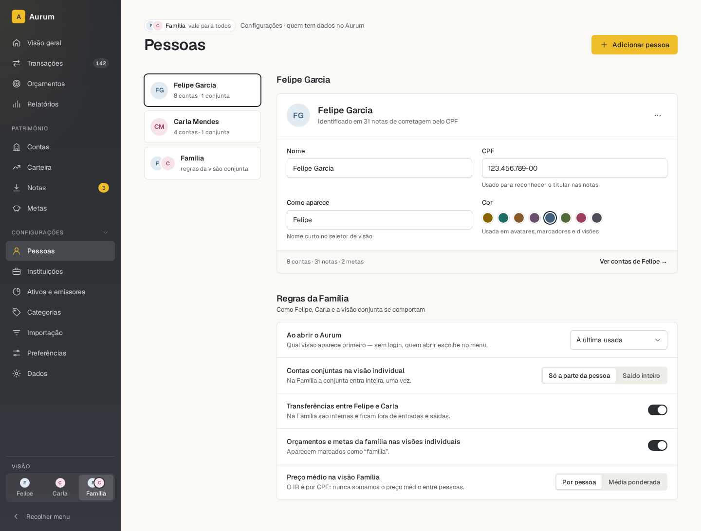 | 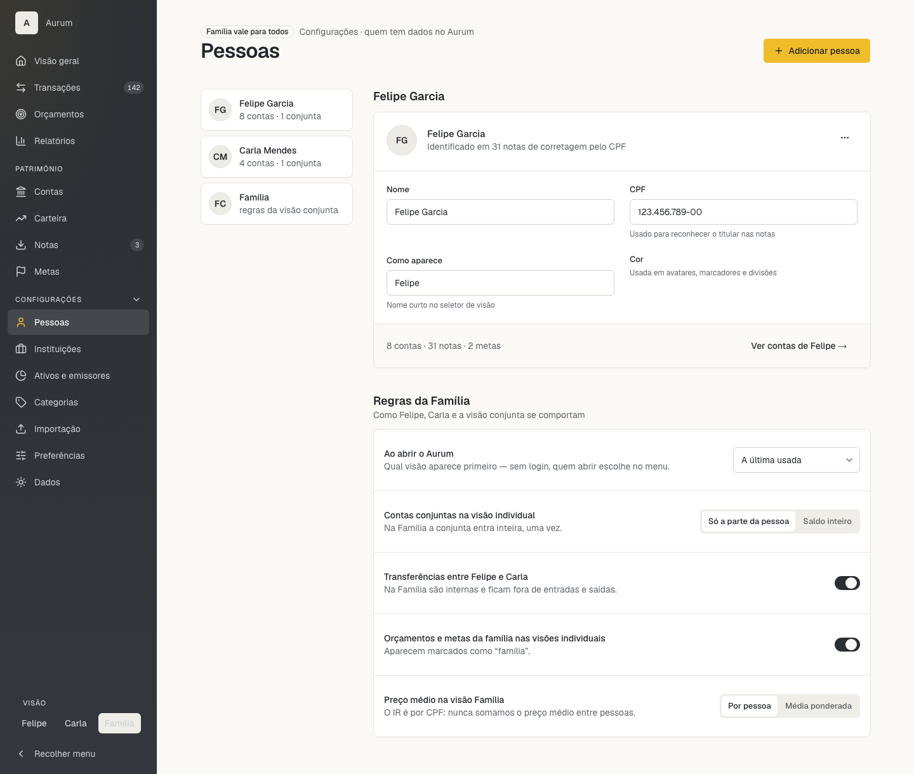     | 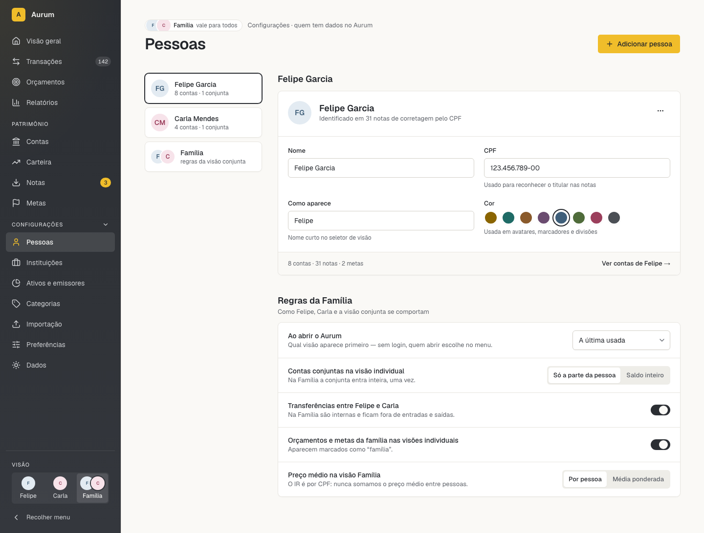       |

| Question                              | Result [M]                                                                                                                                                                                                                                         |
| ------------------------------------- | -------------------------------------------------------------------------------------------------------------------------------------------------------------------------------------------------------------------------------------------------- |
| How close does shadcn get?            | Theme alone: rail, paper and structure, and it still reads as shadcn. With 33 look lines and 6 of behaviour: gold, sizes and the rail. With own pieces in Tailwind, no CSS file of their own: near the prototype **on 2 screens, by eye, at rest** |
| Does a clean `moneta` work?           | `make check` green through Docker, about 50 s, **on 8 shadcn files and one own piece,** with checks narrowed (Appendix A). 53 files carried                                                                                                        |
| Can the old interface stay untouched? | **Yes at rest:** all 8 of its approved photos, of 4 screens, pass pixel for pixel in the app's image, with Moneta's theme in the same stylesheet. Focus and hover were not compared                                                                |
| Is a monorepo needed for a fast loop? | Not for what was tried: an own piece or the theme reached the page in 94 to 129 ms inside containers. shadcn's mixed-export files go stale after the first edit and need a reload, about 480 ms                                                    |
| Does shadcn bring accessibility?      | **Not all of it.** React Aria brings much of the behaviour, and repairs remain: section 6. Aurum's existing sweeps caught none of them. Rewritten, they caught the forced-colours and text-spacing faults                                          |
| How fast will reviewed work be?       | **Unmeasured.** The trials are unreviewed. The first screen measures it                                                                                                                                                                            |

**The recommendation.**

1. **Start `fgarend/moneta` as a new repository,** and archive `aurum-ds` once the client has moved. Section 3.
2. **Take shadcn's way as the default:** `aria-nova` on React Aria, its CLI, token names, variant names, parts. Sections 4 and 5.
3. **Follow the migration plan you already decided:** new screens in `src/v2/` by `versioned`, in the order Pessoas, Posição, Notas,
   Nota. Only the library underneath changes. Section 7.
4. **Reach the client in one thin first slice:** repository, theme, rail. Then screen by screen. Section 8.

**The price, plainly.** Three of the five families die and two shrink. Coverage stops meaning "all code". Accessibility that
Aurum built on purpose must be rebuilt on top of shadcn. Most adopted pieces get edited: the first trial edited 61 lines of 3,133,
and the map marks 36 of 57 adopted pieces as edited [R]. Upgrades stay a merge by hand. The separate package is itself a deviation from shadcn's documented routes.

## 2. The rule

For each need, stop at the first step that gives the right result.

|     | To change a shadcn piece                                                                                  | To make something new                                                          |
| --- | --------------------------------------------------------------------------------------------------------- | ------------------------------------------------------------------------------ |
| 1   | **Use it as is,** and adapt ourselves. Example: `Sidebar` collapse and mobile sheet                       | **Use what exists.** Example: `SettingRow` is `Field orientation="horizontal"` |
| 2   | **A value or rule in `theme.css`.** Example: the graphite rail through `--sidebar-*`                      | **Compose,** Tailwind only. Example: `PageHeader`, `Section`                   |
| 3   | **Edit its file, recorded in the commit.** Example: a `gold` Button variant, `aria-current` on rail links | **Own code,** with its reason. Example: `Amount`                               |

This follows shadcn's [customization skill](https://github.com/shadcn-ui/ui/blob/main/skills/shadcn/customization.md): built-in variants, `className`, a new
`cva` variant, wrappers last [V]. It adds one thing: a theme rule comes before an edit, when it works, because it can't conflict on upgrade [R].

**What the rule does not override:** WCAG 2.2 AA, money shown exactly, no spacing or colour written in a screen, pt-BR, fictitious data.

**"It must make sense" works both ways.** A difference from the prototype is not automatically a reason to edit: a card at 8.4 px instead of 8 costs
nothing to accept. Gold, the rail and the money typography are the look itself.

## 3. The new repository

`fgarend/moneta`, `@fgarend/moneta` and `fgarend/aurum` are free, as seen by this account [V]. `moneta` alone on npm is a third party's stub, which the scope avoids.
`fgarend/aurum` is already the client's name in the plan (M7) [V].

| Option                               | For                                                                                                                              | Against                                                                                                  |
| ------------------------------------ | -------------------------------------------------------------------------------------------------------------------------------- | -------------------------------------------------------------------------------------------------------- |
| **A. New repository**                | Born as a shadcn project. No sweep of 657 lines naming Aurum or `au-`, in 89 files [M]. Old code stays intact, reading as it was | History split in two. CI, Pages and releases set up again. About 150 citations of decisions to deal with |
| B. Rename this one, rewrite in place | One history, tags and URLs kept, CI working throughout                                                                           | About 90 of its files go anyway [R]. Old tags and changelog sit under a new name                         |

**Recommendation: A, on clarity more than cost.** The client pins a release tarball, so the old code is safe under either. The trial left 382 files behind, but 289 of those are `reference/` and
decisions, which would also stay under B. Costs are close. What decides it is a repository that reads as what it is, from the first commit. The risk is repeating the first four days
of tooling decisions, so **the pipeline travels in one step** (question 2). In the trial, the first green `make check` came about 13 minutes in, unreviewed and with lessons from the first trial.

**What travels, and why** ([every path](direction/v2/reports/6-moneta-client.md)):

| Group                                                                                               | Why                                                                                                                     | Trial                    |
| --------------------------------------------------------------------------------------------------- | ----------------------------------------------------------------------------------------------------------------------- | ------------------------ |
| `Makefile`, `infra/`, `ci.yml`, `audit.yml`, `pnpm-workspace.yaml`                                  | Containers, CI and the release age rule hold, and hold no opinion about styling                                         | Few lines edited         |
| `build-package`, `check-package`, `check-release`, `extract-release-notes`, `update-screenshots`    | Build, release and photo tooling                                                                                        | Mostly unchanged         |
| `check-pins`, 912 lines with tests                                                                  | Pins of actions and images. **The one to question:** it works as is, and could be dropped                               | Unchanged                |
| `.storybook/`, `vitest.config.ts`, `biome.jsonc`, `tsconfig*`                                       | Stories in 3 browsers, axe, the settings of section 4                                                                   | Edited                   |
| Tests that keep meaning: accessibility table, build, coverage, workflows, workspace, fonts, package | Their rules still hold                                                                                                  | 5 unchanged, 2 edited    |
| Forced colours, text spacing, contrast, class scan, a story per file                                | Rewritten, section 6                                                                                                    | New                      |
| **The 46 stories,** 1,623 lines                                                                     | State what must hold. Ported to each family as it arrives: what fails shows what shadcn lacks                           | Not ported yet           |
| `docs/accessibility`, `consumers`, `releasing`, `updating`, `README`, `CLAUDE.md`                   | Rewritten by hand: the trial only renamed them                                                                          | Edited                   |
| `docs/guidelines.md`                                                                                | **Rewritten as an output of the theme,** not a spec for it                                                              | Left behind, recommended |
| **The prototypes,** `reference/prototype` and `reference/screenshots/prototype`, 65 files, 7.7 MB   | They draw the app's screens, so they go **to the client's repository,** frozen. Moneta consults them there (question 4) | Not in Moneta            |

**I read "templates" in your message as the prototypes,** since you called them that in the first request. If you meant something else, tell me.

**Stays in `aurum-ds`:** `src/`, `tokens.json` and its compiler, `reference/artifact`, the 90 decisions, the changelog. The roadmap's deferred items go to Moneta's roadmap, [each with its status](direction/v2/reports/4-decisions.md).
Of the 90 decisions, by reading: 53 hold, 17 hold with a change, 9 fall, 11 go back to the owner [R].

## 4. The base

**React Aria,** though shadcn's default is now Base UI [V]. It is what the app runs: 843 role queries, 143 of them `grid`, which depends on React Aria's table [M, R].

**Style: `aria-nova`, weakly held.** Only `nova` and `vega` were seen on screen, and only `nova` went through to composed pieces, so its lead partly reflects the trial's effort.

| Style           | Button sizes | For                                               | Against                                                |
| --------------- | ------------ | ------------------------------------------------- | ------------------------------------------------------ |
| **nova**        | 28, 32, 36   | Nearer density and card spacing, by eye           | Needs edits to reach the prototype's 40 and 32         |
| vega            | 32, 36, 40   | Holds both sizes the prototypes use, with no edit | Its small Card stacks the avatar over the text. Taller |
| mira, the app's | From 28      | Matches the app's file                            | Not seen                                               |

The style can change later by editing `components.json`, as the trial did: the real cost is reapplying edits. **So compare again on the first screen, before many edits exist.**

**The CLI.** `init` refuses a library: "We could not detect a supported framework" [M]. `add` works with a hand-written `components.json`, the dependencies and five aliases that resolve [M].
Each `add` is committed untouched and tagged, so that commit is the merge base and `git log` the list of edits. `git merge-file` worked in a test with `aria-vega` standing in for a newer release: a new variant merged clean, and two edits on one long class line gave a conflict [M]. No real upstream release has been tried.

**Layout, as shadcn's aliases expect [M]:** `src/components/ui/` for shadcn's files, `src/components/` for own pieces, `src/lib/`, `src/hooks/`, `src/styles/theme.css`. Imports `@fgarend/moneta/ui/button`, `@fgarend/moneta/Amount`.

**Names and API are shadcn's:** `variant` `default`, `secondary`, `outline`, `ghost`, `destructive`, `link`, `size` `default`, `sm`, `lg`, `icon`, and parts rather than props. A new `gold` variant. Aurum's "secondary" Button is shadcn's `outline` [V].

**Settings.** Details in Appendix A. In short: `isolatedDeclarations` off, since it gives 105 of 118 errors and `cva` depends on inference [M]. `exactOptionalPropertyTypes` stays on, as in the app, with about 12 small edits, because it protects money code [R]; that also needs `skipLibCheck` on, or React Aria's own types fail [M]. Lint off on `ui/` so upstream diffs stay clean, with one read of Biome's findings when a file is adopted. Coverage 100% on own pieces only, since `ui/` sat at 66%.

## 5. Theme and pieces

### Theme

**One `theme.css` in shadcn's format,** `:root`, `@theme inline`, base layer, values in hex, as shadcn's skill says to keep them when the design gives hex [V]. **Start from shadcn's list, and add a name only when a named screen fails without it.** That gives about 30 added names against today's 96 tokens [R]. Spaces and heights go, since Tailwind's scale matches by number [V]. Shadows take Tailwind's names, with the prototype's values.

| shadcn's name                   | Value from              | Note [M unless marked]                                                                                |
| ------------------------------- | ----------------------- | ----------------------------------------------------------------------------------------------------- |
| `background`                    | Prototype's warm paper  | Three places paint it where the prototype is white, such as the switch thumb. Barely visible          |
| `foreground`, `card`, `popover` | Prototype               |                                                                                                       |
| `primary`, `ring`               | Prototype's graphite    | Gold in `ring` would be 1.75:1                                                                        |
| `secondary`                     | To be weighed           | A filled quiet button, which the prototype's Button does not have                                     |
| `muted`, `muted-foreground`     | Prototype               | `muted` paints much of shadcn, including hover: one step darker than the prototype's hover            |
| `accent`                        | Prototype's hover wash  | The highlighted row of menus, comboboxes and Select. **Not gold**                                     |
| `destructive`                   | **The app's red**       | #b42318 passes on 3 tinted states where Aurum's #c4281c fails. Both fail `/20` over paper and `muted` |
| `border`, `input`               | Prototype               | `input` fails 3:1 in all sources: prototype 1.54, app 1.46. Deferred to the field's item              |
| `chart-1` to `-5`               | Prototype               |                                                                                                       |
| `sidebar-*`                     | Prototype's rail        | A Badge or Select inside the rail needs the surface rule of 0087, under the new names                 |
| `radius`: `.375rem`             | Shadcn's mechanism      | Buttons and fields 6 px, cards 8.4 against 8. A few pieces need a class                               |
| `font-sans`, `font-mono`        | Geist, as the prototype | The app's Instrument Sans stays with the old interface                                                |

| Added, in shadcn's way           | Needed by                                                                                          |
| -------------------------------- | -------------------------------------------------------------------------------------------------- |
| `gold` and its pairs             | The main action, most screens                                                                      |
| `income`, `expense`, soft fills  | `Amount`, 11 screens drawing it directly. Spending is not an error, so not `destructive`           |
| `warning`, soft fill             | `Badge`, allocation differences                                                                    |
| `category-1` to `-8`, soft fills | `IconTile`, 20 screens                                                                             |
| `subtle-foreground`              | The app's name, **Aurum's value:** the app's #8b8e96 is 3.28:1 on white, a failure in use 27 times |
| `chart-6`                        | The prototypes draw 6 series                                                                       |

**Other results of weighing the app [M]:** its file structure is the model, with shadcn's shape and names. Its dark palette is the only one, and a usable start without its blue. Its dark red, green and amber work on the rail (5.99 to 7.37), where Aurum has none. Aurum's amber (6.22 against 5.19) and focus colour are better. [Every token](direction/v2/reports/1-tokens.md).

**Text styles.** With default `cn`, an invented `text-label` beside a colour is **silently dropped** [M]. So shadcn's skill says `@utility type-*`. It works beside a colour with `cn` unconfigured, and carries case and tabular figures [M]. Its trap: over a base `text-sm`, `text-sm` wins and the rest applies, half done, silently [M], so that base class must come out of the file, as a recorded edit. The app's way, a configured `cn`, needs every import in `ui/` edited, or a module alias, which was not tried.

**Recommendation:** Tailwind's steps first (`text-sm` for body, `text-xs` for caption), and `type-*` where none exists: `type-overline` for its case, `type-amount*` for its figures. For the others, apply the adapt test by photo on the first screen: is 13 px worth it against 14, 22 against 24? Keep what the photo shows is worth it.

**Dark:** none now, as the app's 0204 assumes. Pieces held under 48 guessed values by eye, so `.dark` costs little later. Those values are not a design.

### Pieces: designed, not tried

The map below is design from reading code, and the trials built somewhat different pieces. **`Item`, its headline, was never installed in either trial.** So the 990 lines do not validate this tree: the first screens do. [All 139 pieces](direction/v2/reports/2-components.md).

```text
React Aria, Lucide, Tailwind, cva, cn
│
├── ui/, shadcn's. As is or edited, heights and tones mostly
│   Button  Input  InputGroup  Textarea  Field  Select  Checkbox  RadioGroup  Switch  Toggle
│   ToggleGroup  Card  Badge  Avatar  Item  Table  Tabs  Separator  Progress  Alert  Empty
│   Skeleton  Spinner  Dialog  Sheet  Popover  DropdownMenu  Tooltip  Breadcrumb  Pagination
│   Collapsible  Calendar  Chart  Sidebar
│
├── Own: shadcn has none
│   formatMoney, Amount, Delta    money is the library's reason; no float, real minus, stepped cents
│   IconTile                      three tile systems, sized and toned; shadcn's media has no tone
│   Stat                          label, figure and note, for 14 screens
│   DescriptionList               shadcn has no <dl>
│   AllocationBar                 a segmented bar with a text alternative
│   DateField                     shadcn has no typed date
│
├── Composed, thin
│   PageHeader  Section  AppLayout  SearchField  StatGroup  ChoiceCard
│
└── In the app: knows people, finance objects, routes, or is one screen
    AppSidebar  PersonSwitch  ScopeChip  TransactionRow  BudgetBar  AmountInput  GoalCard ...
```

**A piece moves to Moneta when it holds no domain word and has two screens or more,** money apart [R].

**Few pieces could carry most of it,** by counting the 29 prototype screens: `Item` 267 instances on 26 screens, replacing 11 row patterns. `Badge` 256 on 29, replacing 10 chips and tags. `IconTile` about 195 on 20. `Field` 76 on 17. `Stat` on 14. The counts are [M]. That they can be replaced is [R].

**Our five families:**

| Family      | Under the rule                                                                                  | What it costs                                                                                    |
| ----------- | ----------------------------------------------------------------------------------------------- | ------------------------------------------------------------------------------------------------ |
| `NavList`   | **Dies:** `Sidebar` brings collapse, tooltips, mobile sheet, counts, what 7.40 to 7.42 deferred | Lists, section names and `aria-current` to rebuild. The app adopted `NavList` today, in its 0207 |
| `AppLayout` | **Shrinks** to a composition with the skip link                                                 | shadcn has no such piece, so the name stays                                                      |
| `Tooltip`   | **Dies,** our stories as the test                                                               | Delay 0 by default; a name may read twice                                                        |
| `Icon`      | **Dies:** `LucideProvider strokeWidth={1.5}` works, in portals too [M]                          | The app's concept map stays                                                                      |
| `AurumRoot` | **Becomes providers,** no DOM node                                                              | Its scoping is replaced by section 7                                                             |

**Do not build:** `Sparkline`, `BottomNav`, Accordion, Carousel, Command, Menubar, AI pieces, a TanStack table. **Prototype disagreements:** 20, each with a recommendation in the map, decided as its piece arrives.

**Own pieces cost more than estimated.** The map guessed about 9 small pieces, and the trial wrote 990 lines in 8 files, 280 of them the rail. Nobody reviewed them.

## 6. Accessibility

WCAG 2.2 AA stays the target, and `docs/accessibility.md` stays binding. Trust moves from hand-made code to React Aria plus shadcn's composition, and only stories can show which is right. No audit of shadcn's React Aria base was found [V]. **No screen reader was used on anything.** Forced colours were emulated in Chromium and Firefox: no real Windows High Contrast.

**The three that matter most** ([all of them in Appendix B](#appendix-b-faults-found)):

1. **Focus.** shadcn draws it with a shadow ring, gone in forced colours, and its halo is 2.94:1. [Its own focus rule](https://github.com/shadcn-ui/ui/blob/main/skills/shadcn/design-system.md) fixes that with no file edited on the 6 pieces probed. **As written it fails:** 1.07:1 on the rail, and nothing on Switch and Checkbox. Two additions fix those [M]. Not tested: menus and options, mouse focus (shadcn's issue #11258), focus returning from a dialog. It is global, so it reaches the old interface through `revert-layer` lines not fully proven. **Test those before deciding.**
2. **The rail lost what Aurum built:** no `<nav>`, menus as `div`s, section labels naming nothing, no `aria-current`, no skip link. This is the one place where adopting is **worse than what exists.**
3. **Real bugs:** Esc does not close the mobile sheet from a link with a `tooltip`, and the sheet stays open after navigating [M].

**Checks come with the pipeline.** Aurum's two sweeps passed on pieces proven broken, since they look only at `au-` classes. The rewritten ones already exist from the trial, each shown failing on a planted bad story [M]: forced colours 127 lines, text spacing 75, contrast with opacity 149, class scan on own pieces 65, a story per file in `ui/` 22, about 440 in all.

**Their limit:** they see rest states, and no check here would have caught the Esc bug. **So behaviour the app depends on gets a story, whoever wrote the code.** Reduced motion needs a check, now that things animate.

## 7. Fitting the client

**The plan already answers most of this.** M11 and app 0186 say: same addresses, a preference for the version, new screens in `src/v2/`, `versioned({ v1, v2 })` per route, tests in both through `inBothVersions`. M12 sets the order: the shell, Pessoas, Posição, Notas, Nota, then the rest by area. Phase 4 has the table of 27 routes, and phase 6 the close. **All of this stays. Only the library changes.**

**So the old interface stays frozen by construction:** old screens keep `components/design` and `ui/`, and new screens import Moneta. Today's use of `aurum-ds` is small: 3 source files and 7 CSS variables [V].

**What is new:**

1. **Themes side by side. Works at rest [M].** Moneta's `:root` applies under the new interface, and the old values move to `:root:not([data-ui="v2"])`. Fonts and radii read run-time variables. `index.css` +85 −26, code in Appendix C. 8 of 8 old photos pass.
2. **Old screens under the new interface take Moneta's colours,** through shared token names, and keep their old shape until rebuilt. That is cheap. It also showed a trap: table links turned graphite and no test noticed, while `--primary-soft` stayed blue.
3. **The rail must arrive with its edits.** Untouched, it is worse than today's:

| Today's approved new interface                  | Trial: shadcn's `Sidebar` with none of the edits |
| ----------------------------------------------- | ------------------------------------------------ |
| 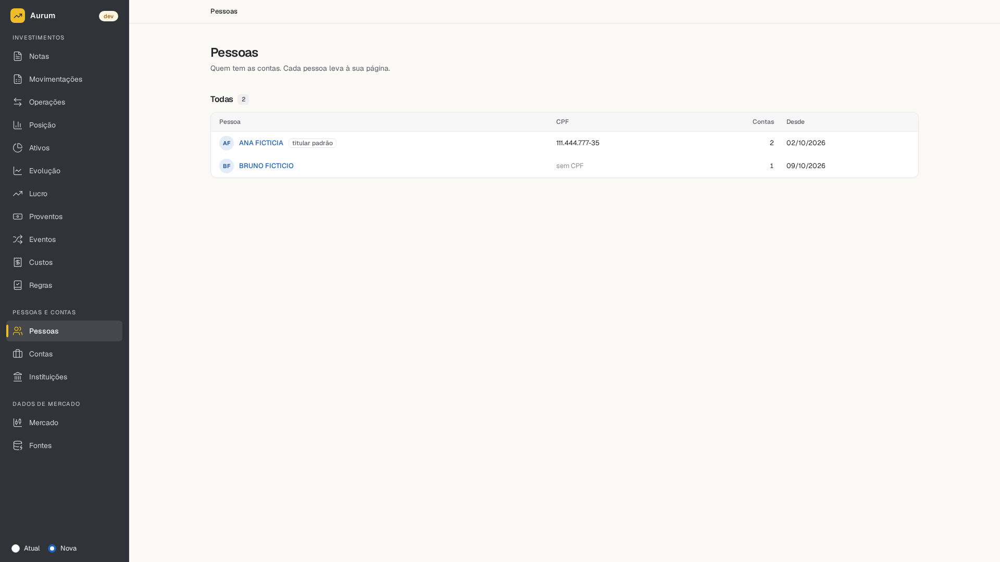 | 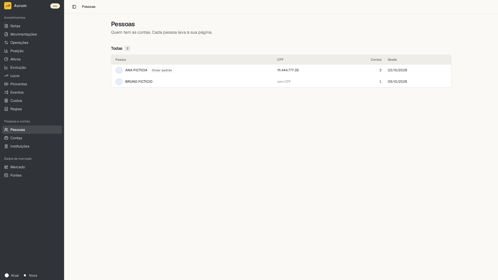   |
4. **Links.** `createLink(SidebarMenuButton)` looks fine **but Enter does a full page load,** cause not diagnosed [M]. React Aria's `RouterProvider` works with mouse and keyboard, in Chromium and WebKit, Firefox not run [M]. It loses the typed `to` as tried. React Aria's `RouterConfig` may restore it, read in its types, not tried [V, R].
5. **React Aria as a peer.** A duplicate gives 0 type errors, a green build, and links that silently stop going through the router [M]. With a peer: one copy, JS +3.0%, CSS +18%, on the rail and one Button so far.
6. **Guards.** 14 files, +303 −122 in the trial [M], listed in [the report](direction/v2/reports/6-moneta-client.md). A new guard should stop old screens importing Moneta and new screens importing `design` [R].

**Delivery is a deliberate deviation.** shadcn documents a monorepo inside one repository, and a registry across repositories, and it neither documents nor forbids a separate package [V]. The owner chose the package, as today (question 6): one tested copy, a version to pin, in its own repository. Its costs: the CLI can't update what the app imports, `tsc` in the app sees a changed prop only after a pack, and few public cases exist. Polar and Medusa publish from monorepos, so neither shows a separate-repository consumer [V]. **A local link is left out for now.** It worked in what was tried, with a mount and 22 lines of `vite.config.ts`, while `make watch` and `button.tsx` gave no result yet. It enters as a step of its own if publishing a version per change gets in the way.

**What was tried and is not recommended [M].** Delegating `design/Button` to Moneta for both versions broke 6 of 8 old photos, while unit tests stayed at 510 of 510. Choosing by `data-ui` at render kept all 8, at 12 lines of logic per family. The plan makes that unnecessary. The lesson stays: **photos are the only witness of the look.**

**One choice the plan leaves open:** when the new interface becomes the default (6.1). The plan's order suggests after all 27. I recommend after M12's four, which keeps the old interface reachable and starts real use sooner [R]. Retiring the old interface would then drop the dark theme and the comparison, and also the pins and the 8 old photos. Your call.

## 8. Roadmap

**In Moneta,** one commit per step. Each milestone from 1 on ends with the client using it.

| #   | Milestone                           | What                                                                                                                                                                                                                                                                                                                                                                       | Done when                                                                                                                                          |
| --- | ----------------------------------- | -------------------------------------------------------------------------------------------------------------------------------------------------------------------------------------------------------------------------------------------------------------------------------------------------------------------------------------------------------------------------- | -------------------------------------------------------------------------------------------------------------------------------------------------- |
| 0   | **Decide**                          | Questions 1 to 7, done. The owner creates the repository. In the client, the prototypes arrive in a commit of their own                                                                                                                                                                                                                                                    | Moneta's first roadmap reflects them                                                                                                               |
| 1   | **First slice: rail in the client** | Commits, in order: (a) pipeline carried by groups, with the sweeps, a minimal `Button` and story, planted failures, each group reviewed, (b) `components.json` and the first `add` untouched, tagged, (c) `theme.css`, asking the theme questions with the page open, (d) rail edits, `AppLayout`, providers, stories ported, (e) CI, gallery, release 0.1.0, by the owner | **Client:** shell on Moneta. 8 old photos unchanged. 4 new photos approved by the owner. axe run on the shell. Keyboard, Esc and the sheet checked |
| 2   | **Pessoas**                         | What it pulls, through the rule                                                                                                                                                                                                                                                                                                                                            | Near its prototype. **Sets the speed baseline**                                                                                                    |
| 3   | **Posição, Notas, Nota**            | What they pull. Money arrives with Posição, and `Amount` is the hardest test of the look                                                                                                                                                                                                                                                                                   | M12's four approved. Default decided                                                                                                               |
| 4   | **The other 23 routes, by area**    | The plan's table                                                                                                                                                                                                                                                                                                                                                           | All under the new interface                                                                                                                        |
| 5   | **Close**                           | The plan's phase 6. Old screens, `design`, the app's `ui/` and its CLI leave. `aurum-ds` archived. Accessibility script run                                                                                                                                                                                                                                                | 1.0.0                                                                                                                                              |

**In `aurum-ds` until question 1 is answered:** nothing changes, and 7.7 waits. After it, the open items of its milestone 7 become pieces pulled by screens. [Item by item](direction/v2/reports/4-decisions.md).

**The plan needs edits,** in the app's repository, when this is adopted: names, phase 2's text, M5's package.

**One measure:** time from starting a screen to the app using it. **Stop rule:** if a screen takes twice the baseline, stop and review. This matters because tooling was the trap: it applies from milestone 2, since the first slice is tooling by design.

## 9. Questions, in order

**Answered by the line, to confirm only:** shadcn is the base. Tailwind everywhere from the start, own pieces too, so plain CSS goes. Tokens in shadcn's pattern with no bridge. Names and construction may change.

**Real questions, one at a time:**

| #   | Question                                                                                                   | Recommendation                                                                                                                                                                                                                                                                                                                                                                                                                             | When        |
| --- | ---------------------------------------------------------------------------------------------------------- | ------------------------------------------------------------------------------------------------------------------------------------------------------------------------------------------------------------------------------------------------------------------------------------------------------------------------------------------------------------------------------------------------------------------------------------------ | ----------- |
| 1   | New repository, or rename this one?                                                                        | **Decided by the owner, 2026-11-04: new**                                                                                                                                                                                                                                                                                                                                                                                                  | Now         |
| 2   | Pipeline carried in one step, rather than tool by tool?                                                    | **Decided by the owner, 2026-11-04: yes, with one record and small commits by group.** Each group is run for real, with a minimal `Button` and story and planted failures, and reviewed: unchanged files as a list, edited ones as a diff against `aurum-ds`, what stayed behind with its reason, and the commands' results. CI and release stay declared as untested until the owner's push                                               | Now         |
| 3   | Decision records: start numbering at 0001, with a list of what is inherited and links?                     | **Decided by the owner, 2026-11-04: start anew, leaving the 90 in `aurum-ds`. Files by topic in `docs/decisions/`, stating what holds today and edited when it changes, each with a `History` section of one sentence per change, condensed when it grows too much, pointing to older versions in git. Only what deviates from shadcn, is costly to reverse or cannot be read from the code gets in.** Condense past 10 lines, as proposed | Now         |
| 4   | Copy the prototypes?                                                                                       | **Decided by the owner, 2026-11-04: `prototype` and its screenshots go to the client's repository, unchanged, in a commit of their own there. Moneta consults them from there. The artifact stays in `aurum-ds`**                                                                                                                                                                                                                          | Now         |
| 5   | React Aria rather than Base UI?                                                                            | **Decided by the owner, 2026-11-04: React Aria**                                                                                                                                                                                                                                                                                                                                                                                           | Now         |
| 6   | Package with a local link, as a deliberate deviation?                                                      | **Decided by the owner, 2026-11-04: a package as today, a generated version, with `package.json` pointing to it on GitHub.** The local link is left for when the daily loop needs it                                                                                                                                                                                                                                                       | Now         |
| 7   | Moneta public, and released by GitHub tarball as today? The client's repository private?                   | **Decided by the owner, 2026-11-04: Moneta public, by tarball as today. The client's repository private, in principle**                                                                                                                                                                                                                                                                                                                    | Now         |
| 8   | Which style?                                                                                               | `nova`, compared on Pessoas                                                                                                                                                                                                                                                                                                                                                                                                                | Commit (b)  |
| 9   | `exactOptionalPropertyTypes` kept on, with the edits?                                                      | Yes                                                                                                                                                                                                                                                                                                                                                                                                                                        | Commit (b)  |
| 10  | Default control 40 px, against nova's 32? It's the largest visible difference                              | Yes                                                                                                                                                                                                                                                                                                                                                                                                                                        | Commit (c)  |
| 11  | Own text styles: how many?                                                                                 | The fewest a photo justifies                                                                                                                                                                                                                                                                                                                                                                                                               | Commit (c)  |
| 12  | Rail's gradient and glow back? 0087 made it flat, and the token report prefers flat                        | Yes, by eye                                                                                                                                                                                                                                                                                                                                                                                                                                | Commit (c)  |
| 13  | Does the app's rule "profit and loss have no colour" (0094) yield to the prototype, which colours amounts? | Yes, by the line. 187 uses in screens                                                                                                                                                                                                                                                                                                                                                                                                      | Commit (c)  |
| 14  | shadcn's focus rule, widened, dropping the gold halo? Gold at `/50` is 1.29:1                              | Yes, after the tests of section 6                                                                                                                                                                                                                                                                                                                                                                                                          | Commit (c)  |
| 15  | `RouterProvider` for the rail?                                                                             | Yes, after trying `RouterConfig`                                                                                                                                                                                                                                                                                                                                                                                                           | Commit (d)  |
| 16  | Money as a decimal string (D1)? `Intl` is exact on it in 3 browsers                                        | Yes                                                                                                                                                                                                                                                                                                                                                                                                                                        | Posição     |
| 17  | When does the new interface become the default?                                                            | After M12's four                                                                                                                                                                                                                                                                                                                                                                                                                           | Milestone 3 |
| 18  | Where does `recharts` go, as most of the 963 KB comes from it and React Aria?                              | Its own entry, when a chart arrives                                                                                                                                                                                                                                                                                                                                                                                                        | First chart |
| 19  | `BottomNav` dropped, and tables on phones?                                                                 | Dropped. Phones decided on the first table                                                                                                                                                                                                                                                                                                                                                                                                 | Pessoas     |

**Defaults, which you can object to at any time, without a question from me.** Each is recorded when its commit depends on it:

- The rule of section 2 goes into `CLAUDE.md`.
- **Process:** one family or screen as an item, release when a screen needs it. Decisions by topic, as in question 3. Test first through a story that fails on our edit. Update routine per family, with a hand check for the registry. **Unchanged:** never guess, no unilateral decisions, one point per question, accessibility in the open, fictitious data, small steps, commit on approval, the owner pushes.
- `ui/` beside own pieces. shadcn's names and parts. `gold` as a variant.
- Each `add` committed untouched. Lint off on `ui/`, with one read per file. `isolatedDeclarations` off. Coverage on own pieces, a story per file in `ui/`.
- The theme tables of section 5.
- The five families as in section 5. Pieces with no default text.
- React Aria, Lucide and Tailwind as peers. Tailwind's and Lucide's were not measured.
- Light only for now. Guidelines rewritten from the theme.

## 10. Risks

| Risk                                                                                                 | Answer                                                            |
| ---------------------------------------------------------------------------------------------------- | ----------------------------------------------------------------- |
| Starting over repeats the tooling days                                                               | Question 2, and one milestone for the first slice                 |
| Accessibility regresses from what Aurum had                                                          | Sweeps from the first commit, stories ported, script before 1.0.0 |
| Checks pass while seeing nothing                                                                     | It happened. Each new check is shown failing first                |
| Lower bars: no lint on `ui/`, coverage on own only                                                   | Stated, and reversible per setting                                |
| The look drifts to "another shadcn app"                                                              | Rail first, then money. Photos per screen                         |
| Unit tests stay green while the look breaks                                                          | Measured. Photos are the witness                                  |
| `cn` or `type-*` lose a class silently                                                               | Section 5's rule, and photos                                      |
| Adopted code is ours, with no upstream merge                                                         | Tagged `add` commits, and fetching only for a bug or a need       |
| shadcn changes direction: in 2026 a new default base, a new `cn`, 3 styles, CLI from 3.6 to 4.23 [V] | Code is ours. CLI pinned                                          |
| `cn` is very young, and every piece imports it                                                       | Pinned, small                                                     |

## 11. What could not be checked

- **Speed in reviewed work,** on any path.
- **Screen readers,** and real Windows High Contrast.
- **The look beyond 2 screens and beyond rest states.** Rankings are by eye.
- **The quality of the trials' 990 lines,** and the tree of section 5, which was not built.
- **A real upstream release merged.** A style stood in.
- **The old interface's focus and hover against a baseline, axe on the client's new interface, Firefox on the client's rail.**
- **`make audit`, `outdated`, `storybook-build`, release targets, the workflows on GitHub** in the new repository.
- **A peer out of range, `make watch` with the link, whether archiving keeps release downloads working.**
- **Daily-loop timings and the `createLink` result were reported by the trial,** and their raw output was not saved, though the scripts were.
- **Whether "base Aurum on shadcn" was ever said** before the first direction's request: Claude Design and Cowork conversations were not searched.
- **The other shadcn styles,** apart from `nova` in full and parts of `vega` and `mira`.

---

## Appendix A. Toolchain, measured

| Setting                      | Trial's choice                                 | Effect                                                            | Cost                                                                    |
| ---------------------------- | ---------------------------------------------- | ----------------------------------------------------------------- | ----------------------------------------------------------------------- |
| `isolatedDeclarations`       | Off                                            | 105 of 118 errors gone                                            | Reverses 0013                                                           |
| `exactOptionalPropertyTypes` | First trial on with 12 edits. Second off       | **Recommended on.** With it off, own pieces lose the check        | Long-term edits in `ui/`                                                |
| `skipLibCheck`               | On when the above is on                        | React Aria's own 6 TS2320 errors                                  | Pack check keeps it off, and drops the flag above                       |
| Biome on `ui/`, `hooks/`     | Off                                            | `sidebar.tsx` shows 0 `--diff` lines, against 37 after formatting | No lint on upstream code. On 16 files: 5 errors, 10 warnings, some real |
| Coverage                     | 100% on own pieces                             | `ui/` 66%, all 70%                                                | Says nothing about `ui/`                                                |
| Class literals               | Refused in own pieces                          | shadcn itself has 46 bracket lengths and 62 half steps            | Strings merged by `cn` are not seen                                     |
| `minimumReleaseAge`          | Unchanged                                      | Refused `cn@0.5.2`, `0.5.1`. `0.5.0` installs, as in the app      |                                                                         |
| Aliases                      | `package.json#imports` with a custom condition | shadcn's files stay as written, and the build ships working paths | The condition must not be called `source`: about 600 errors             |
| `shadcn/tailwind.css`        | Copied into the theme, 637 lines               | As an import it brings 226 packages, 70 MB                        | Updated by hand                                                         |

**Also narrowed in the second trial to reach green, stated plainly:** the Sheet story no longer tests Esc, after failing in WebKit through Storybook's `userEvent`, though real Esc works in 3 browsers. One WebKit flake in about 4 runs. Text spacing not judged inside the collapsed rail. Contrast kept 19 of 29 pairs. Only 2 approved photos, none of the Sidebar. Docs renamed only: about 150 citations of decisions now point nowhere. Biome across the repo was clean with those overrides.

**The package [M]:** builds with Aurum's own script. npm and pnpm consumers: one `@import "tailwindcss"` plus `@import "@fgarend/moneta/theme.css"`, classes and theme arrive, 0 type errors with `skipLibCheck` off. The theme carries `@source`, which survives pnpm's symlinks. Moneta's import alone builds and no class arrives. **The first line is required.**

## Appendix B. Faults found

| Fault                                                                                                                 | How found                                    | Fix                                                                                                  |
| --------------------------------------------------------------------------------------------------------------------- | -------------------------------------------- | ---------------------------------------------------------------------------------------------------- |
| Focus: no outline or shadow in forced colours on Button, Link, Trigger. At most a 1 px border on Button, not measured | Measured                                     | Rule in the theme                                                                                    |
| Forced colours: current page, Switch, toggles, tabs lose state. Rail links draw a permanent outline                   | Measured, 17 failures of 46                  | Rail by 2 theme rules, about 8 lines. Others by 4 edited lines. 5 failures left on icons, not judged |
| Inactive Tab, `text-foreground/60`: 3.91 to 4.14:1 by ground                                                          | axe, computed                                | One edit, and a check forbids opacity on text                                                        |
| Text spacing: `Badge` `h-5 overflow-hidden`, Tabs from a fixed height                                                 | **By the first, cruder sweep, not retested** | Edit, not made                                                                                       |
| Esc does not close the mobile sheet from a rail link with a `tooltip`                                                 | Measured                                     | 1 line                                                                                               |
| The mobile sheet stays open after navigating                                                                          | Measured                                     | 3 lines, in the first trial                                                                          |
| Rail: no `<nav>`, `div` menus, unnamed sections, no `aria-current`, no skip link, count outside the link's name       | Read and measured                            | Partly composed in the client's copy                                                                 |
| `SidebarTrigger` has no `aria-expanded` (#11591)                                                                      | Read and measured                            | 2 lines                                                                                              |
| Sidebar writes a cookie and never reads it                                                                            | Measured                                     | `defaultOpen` from the app                                                                           |
| `Field` doesn't link its description or error                                                                         | Read                                         | Not tried                                                                                            |
| `ItemGroup` is `role="list"` with no list items                                                                       | Read                                         | Not tried                                                                                            |
| `Checkbox` draws a check when indeterminate                                                                           | Read                                         | Not tried                                                                                            |
| 16 or more hard-coded English strings                                                                                 | Counted                                      | Props, as the app did with "Close"                                                                   |
| `motion-reduce` in 0 of 42 files read                                                                                 | Counted                                      | A check                                                                                              |

| Focus rule as written, on the rail                  | With the rail's ring                    |
| --------------------------------------------------- | --------------------------------------- |
| 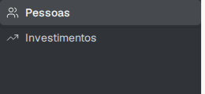 | 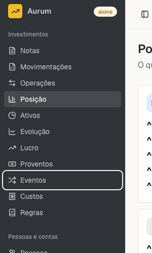 |

[Every WCAG criterion under this line](direction/v2/reports/4-decisions.md).

## Appendix C. The client's stylesheet, as tried [M]

```css
@import "tailwindcss";
@import "@fgarend/moneta/theme.css";
@theme inline {
  --font-sans: var(--ui-font-sans);    /* was a literal */
  --radius-md: var(--ui-radius-md);    /* was 8px */
}
:root[data-ui="v2"]       { --ui-font-sans: "Geist Variable", …; --ui-radius-md: calc(var(--radius) * 0.8); }
:root:not([data-ui="v2"]) { --ui-font-sans: "Instrument Sans Variable", …; --ui-radius-md: 8px; /* and the old colours */ }
```

Not measured one by one: which pins the old interface really needs. `data-ui` is set in a `useEffect`, so a first paint may show the old look [R].

**Daily loop [M, reported by the trial]:**

| Edit in Moneta              | Reaches the page                                                         |
| --------------------------- | ------------------------------------------------------------------------ |
| Own piece                   | HMR, 94 to 116 ms                                                        |
| `theme.css`                 | HMR, 97 to 129 ms, one first edit 1,143 ms                               |
| shadcn's mixed-export files | First edit by HMR, **then stale with no error,** so reload, about 480 ms |
| `button.tsx`                | No result: the page drew the app's own button                            |

## Appendix D. Reports, and where they disagreed

| Report                                                     | What it holds                                                                   |
| ---------------------------------------------------------- | ------------------------------------------------------------------------------- |
| [1-tokens](direction/v2/reports/1-tokens.md)               | Every token in four sources, contrast of 126 pairs, 13 traps                    |
| [2-components](direction/v2/reports/2-components.md)       | 139 pieces against real `aria-nova` code, the tree, 20 disagreements            |
| [3-shadcn-way](direction/v2/reports/3-shadcn-way.md)       | shadcn's documented way, 11 libraries, Tailwind in a package, upgrades          |
| [4-decisions](direction/v2/reports/4-decisions.md)         | All 90 records, every check, 55 WCAG rows, roadmap items, D1 to D10             |
| [5-trial](direction/v2/reports/5-trial.md)                 | shadcn inside this repository's tooling, theme, screens by stage, rail, checks  |
| [6-moneta-client](direction/v2/reports/6-moneta-client.md) | The clean repository, every carried path, type styles, focus, client swap, loop |

**Where this document differs from them, and why:** style (reports chose `vega` and `mira` from class names, and only `nova` and `vega` were seen). Radius (`--radius`, shadcn's mechanism, over explicit values). Rail (a gradient, against the token report, as it is the prototype's). Layout (`ui/` beside own pieces, against a flat folder, since shadcn's aliases expect it). `exactOptionalPropertyTypes` (on, against the second trial). Client (the plan, against per-family branches). **The reports hold some numbers corrected here by the fact check:** role queries, error counts, stories, and line estimates that predate the trials.

## Appendix E. More pictures

| Theme only                                     | Investments, composed                             | Forced colours, after fixes                        |
| ---------------------------------------------- | ------------------------------------------------- | -------------------------------------------------- |
| 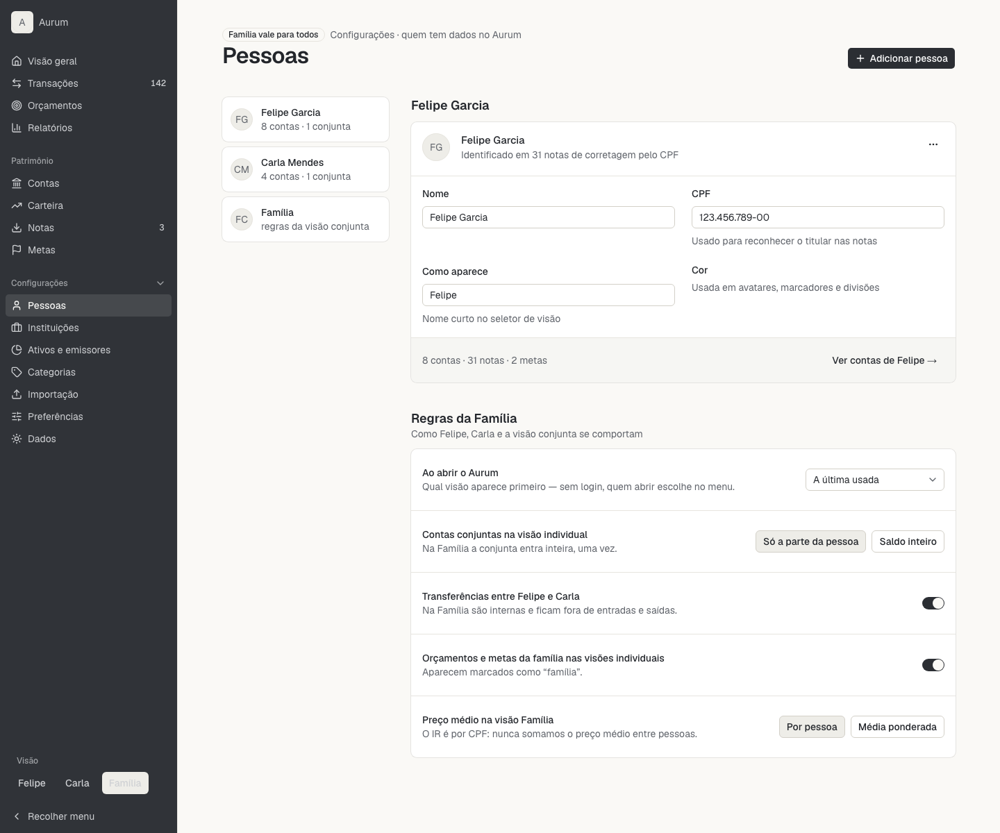 | 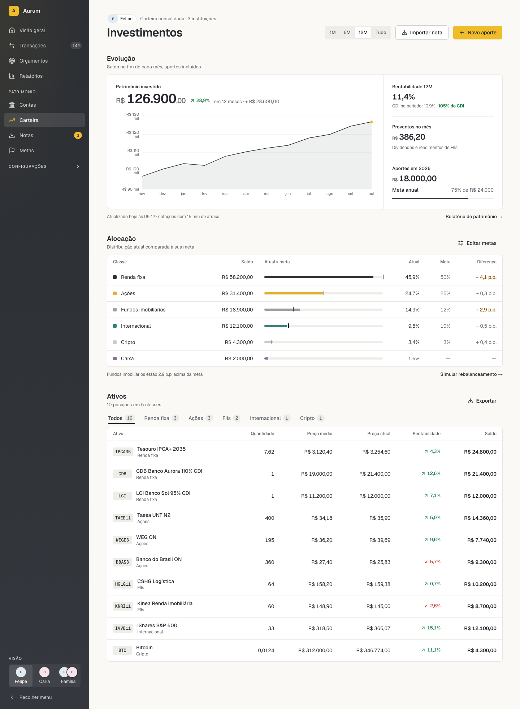 | 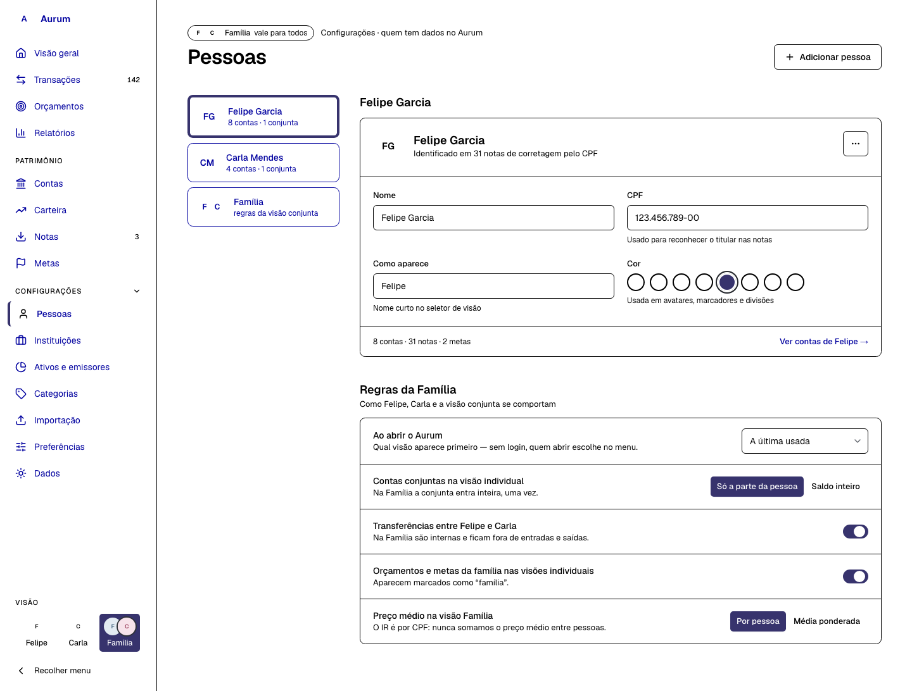 |

| vega, edited                               | At 390 px                                           | Guessed dark, not a design                    |
| ------------------------------------------ | --------------------------------------------------- | --------------------------------------------- |
| 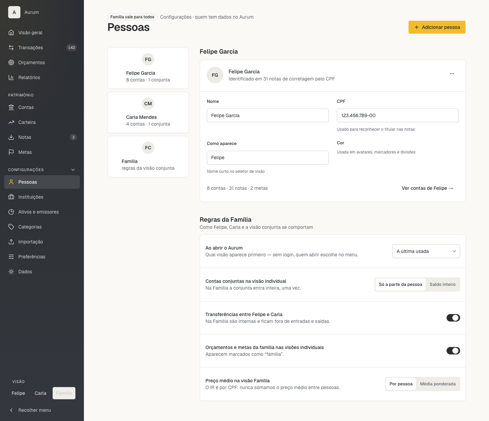 | 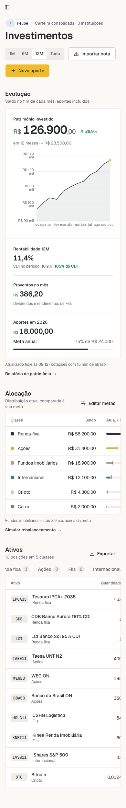 | 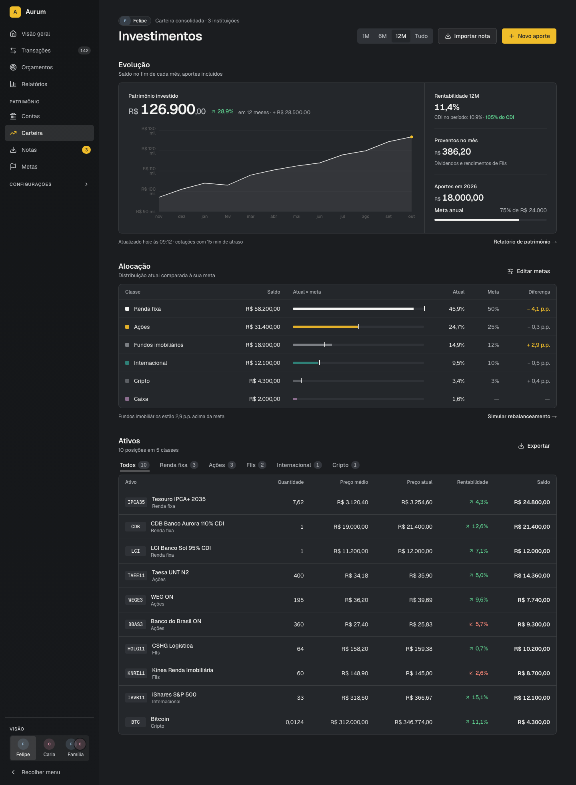 |

| Pieces                                    | Collapsed rail                       | Mobile sheet                            |
| ----------------------------------------- | ------------------------------------ | --------------------------------------- |
| 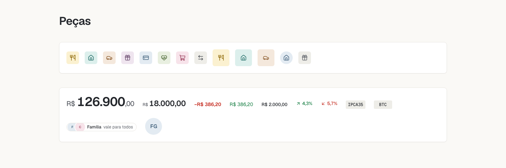 | 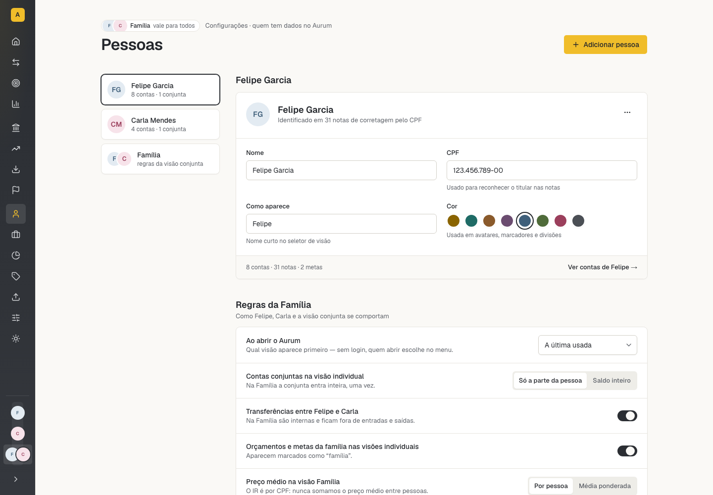 | 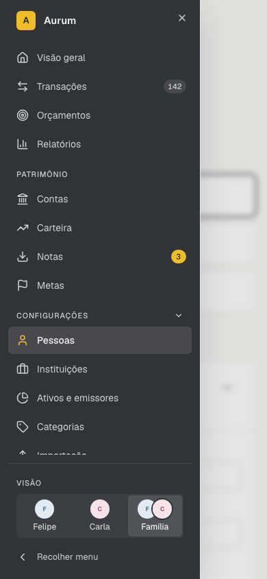 |

## Appendix F. Sources

- shadcn: [docs](https://ui.shadcn.com/docs), [theming](https://ui.shadcn.com/docs/theming), [monorepo](https://ui.shadcn.com/docs/monorepo), [registry](https://ui.shadcn.com/docs/registry/examples), [design-system skill](https://github.com/shadcn-ui/ui/blob/main/skills/shadcn/design-system.md), [customization skill](https://github.com/shadcn-ui/ui/blob/main/skills/shadcn/customization.md), [React Aria base](https://ui.shadcn.com/docs/changelog/2026-07-react-aria), [Base UI default](https://ui.shadcn.com/docs/changelog/2026-07-base-ui-default), [`cn`](https://ui.shadcn.com/docs/changelog/2026-09-cn), [issue 11591](https://github.com/shadcn-ui/ui/issues/11591), [issue 11258](https://github.com/shadcn-ui/ui/issues/11258)
- Tailwind: [registering sources](https://tailwindcss.com/docs/detecting-classes-in-source-files), [theme](https://tailwindcss.com/docs/theme)
- React Aria: [quality](https://react-aria.adobe.com/quality)
- Public cases: [Polar](https://github.com/polarsource/polar/tree/main/clients/packages/ui), [Medusa UI](https://github.com/medusajs/medusa/tree/develop/packages/design-system/ui), [moduix](https://github.com/Blinks44/moduix), [Kibo](https://github.com/shadcnblocks/kibo), [coss](https://github.com/cosscom/coss)
- The app: `.work/MIGRACAO-FRONTEND.md`, `docs/decisions/` 0048, 0094, 0170 to 0172, 0184, 0186, 0204, 0207 to 0209, at commit `f489bb0`
- Aurum: all of `docs/decisions/`, `docs/ROADMAP.md`, `docs/accessibility.md`, `reference/`, at commit `4d5b60d`
