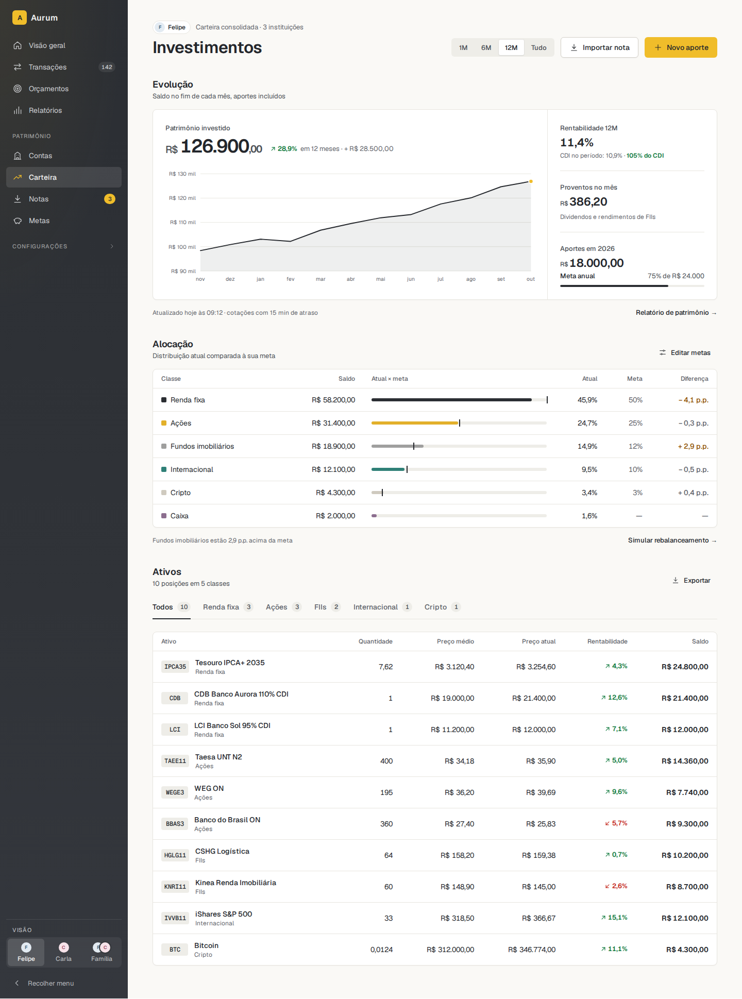
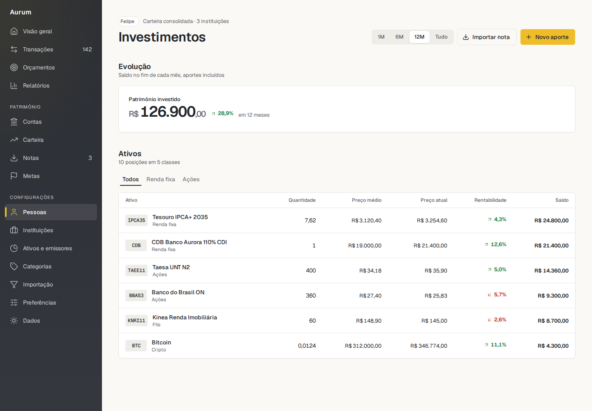
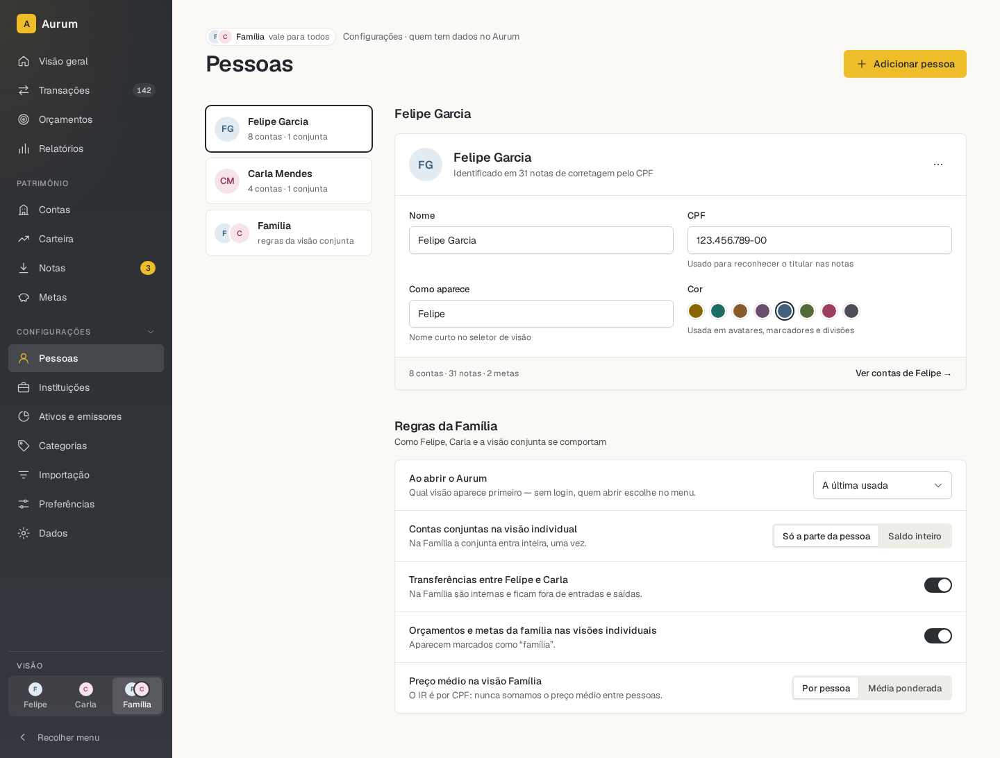
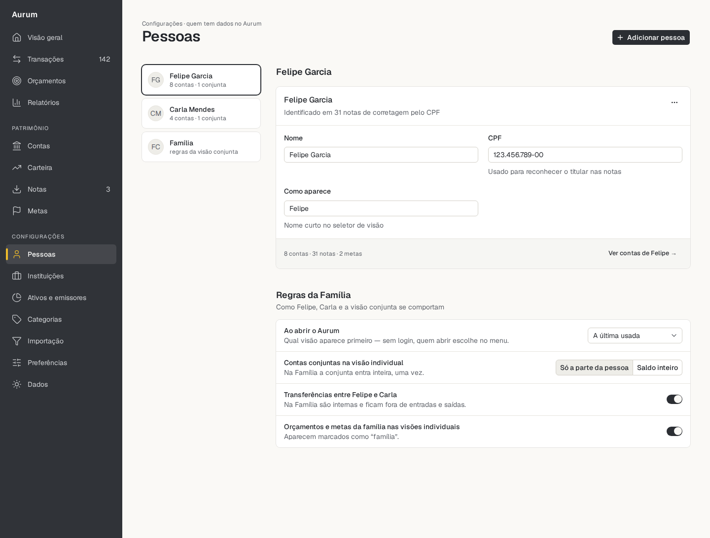
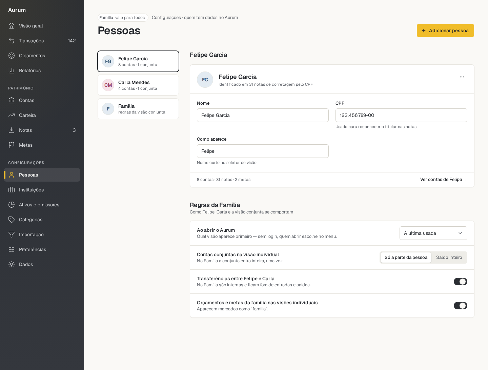
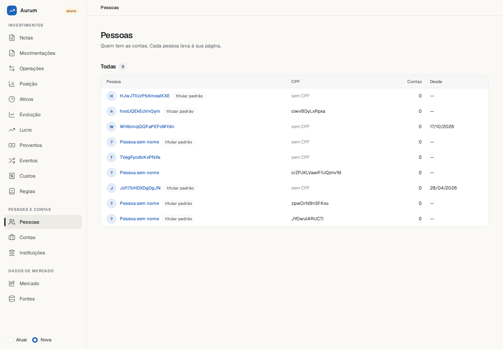
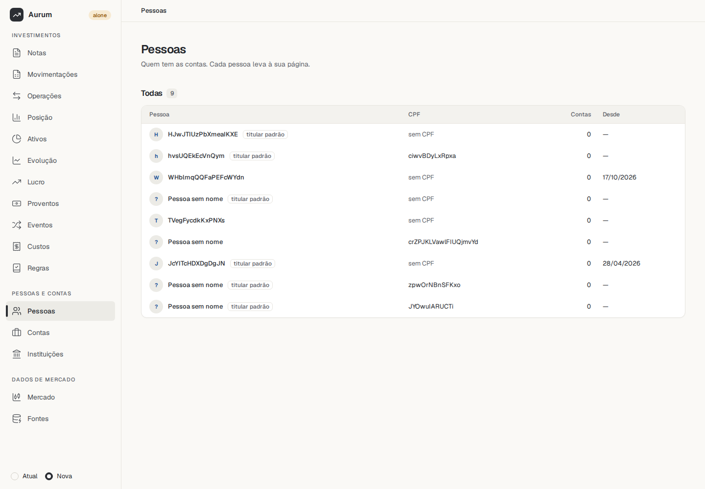
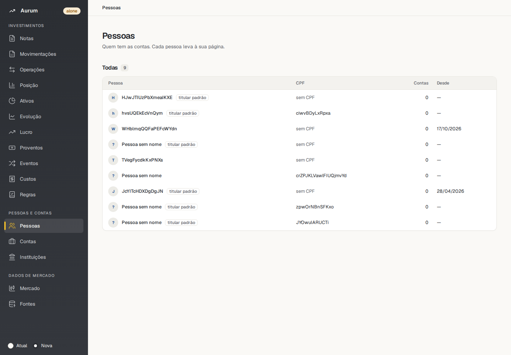

# Aurum direction

Status: **proposal, nothing adopted.** Written on 2026-11-04 from seven research
reports, hands-on trials and two independent reviews. Each choice in section 4 is the
user's to make.

Evidence marks: **[M]** measured here, **[V]** verified in a source or repository,
**[R]** reasoning, which can be wrong.

## 1. One page

**The problem.** In four days Aurum made 126 commits and 90 decision records, for 446
lines of component code in five families [M]. The prototypes hold 27 formal components
and about 90 informal patterns, and 25 of the 27 are missing [M]. Those four days also
built the foundations, which any path would need. Still, at this pace the library will
not speed up the app [R].

**The finding.** The app already runs shadcn on React Aria and Tailwind, under a
vocabulary named after Aurum [V]. Aurum is building the same kinds of pieces by hand, in
another styling system [R]. Starting from that code was never asked as such. Tailwind
appeared once, as one line of a styling question, with plain CSS recommended by the
assistant and approved by the user (appendix C). That line did not say the app already
used shadcn, or what adopting it would bring.

**The trials,** in scratch, with no repository touched:

| Prototype                                                           | Trial: a money screen               |
| ------------------------------------------------------------------- | ----------------------------------- |
|  |  |

| Question                             | Result [M]                                                                                                                                                                                                       |
| ------------------------------------ | ---------------------------------------------------------------------------------------------------------------------------------------------------------------------------------------------------------------- |
| Can shadcn's pieces carry this look? | On two screens, yes in structure and feel, with gaps listed in appendix A                                                                                                                                        |
| What does that cost?                 | 17 lines edited across 8 adopted files, about 155 lines of own pieces, a 56-line token bridge, and 36 `className` strings in the screens                                                                         |
| Does it work as a package?           | Yes, from a tarball under npm. The bridge and imports stayed in the consumer, and pnpm and Aurum's build settings were not tried. A local link reached the screen in under a second, with no reload, on the host |
| Do the app's tests survive?          | 507 of 509, with 11 files swapped, of which 4 no screen imports. The table, the app's top need, was not swapped                                                                                                  |
| Do colours alone give the look?      | **No,** by eye. My hypothesis was wrong. The rail and the pieces carry it                                                                                                                                        |
| Is it accessible?                    | Partly. axe found shadcn's inactive Tab at 4.08:1, and forced colours lose Switch's state. **Aurum's checks would not see these pieces today**                                                                   |

**The recommendation.**

1. **Change the process first.** It is the largest gain, whichever base wins.
2. **Generic controls start from shadcn's `aria-nova` code** on React Aria, and live in
   Aurum, with Tailwind inside them.
3. **Money and identity pieces are ours,** written in plain CSS with the checks that
   already exist.
4. **Start with what shows: the dark rail, then money, then the controls.** Tooling
   comes when a piece needs it, not before.
5. **Move what the app already has** (`formatMoney`, `Section`, `TopCard`) rather than
   writing it again.

**What this does not promise.** Speed in reviewed, tested work is unmeasured. The first
family measures it, and section 3 says what to do with the number.

## 2. Proposals, by context

### 2.1 The base of the components

| Option                                                           | For                                                                                                  | Against                                                                                                            |
| ---------------------------------------------------------------- | ---------------------------------------------------------------------------------------------------- | ------------------------------------------------------------------------------------------------------------------ |
| A. Plain CSS, behaviour by hand (today)                          | Full control, all checks work                                                                        | Writing keyboard and focus behaviour for menus, selects and dialogs by hand. A second system beside the app's      |
| B. Plain CSS plus React Aria                                     | Keeps 0055 and every check. `reference/prototype/assets/aurum.css` already holds the look, 527 lines | Every state of every piece written by us. The brief asked for a shadcn base and speed. Code differs from the app's |
| **C. shadcn `aria-nova` code, Tailwind inside Aurum**            | **Same stack and tests as the app. 62 pieces to start from**                                         | Reverses 0055 for these pieces. Long class strings. Checks must be widened                                         |
| D. Mantine or another complete library                           | Fast at first                                                                                        | Its own look. Replaces the app's base                                                                              |
| E. Everything in the app, no library                             | Fastest now                                                                                          | Drops the library the user wants                                                                                   |
| F. shadcn stays in the app, Aurum holds only tokens and identity | One copy, 0055 stays, no tooling                                                                     | Aurum's gallery cannot show real controls, so it is not yet a design system                                        |

**Recommendation: C as the end state, reached through F's order.** F wins the first
steps: none of the trial's own pieces imports an adopted file [M]. It does not win the
end state, because the user asked for a library. So start like F (section 2.2), and
move controls into Aurum family by family.

**The research disagreed.** The report on React libraries recommended option B, calling
shadcn "good for the app, wrong as Aurum's foundation", with 0055 taken as fixed. **[R]** B
is the honest alternative, and B with a lighter process was not tested. What slowed Aurum
was process more than CSS, so the choice of base alone would not bring speed. The
recommendation of C rests on the brief, the fit with the app and the trials.

**An untried source.** Adobe runs its own registry through the same CLI, with 159 items
including Tailwind components [V]. Compare it with shadcn's `aria-*` on the first family.

**Behaviour.** React Aria, because the app's role-based tests and pt-BR behaviour depend on
it [M]. Decision 0054 already allows a library where no native element gives the behaviour,
so the real change is using it in simple pieces such as Button too.

**Style: `nova`, by eye, and not settled [R].** No style matches. Aurum's sizes are `sm` 32
and `md` 40, with `md` the default, and the prototypes use `md` 59 times, `sm` 36 and `lg`
never. `vega` (32, 36, 40) fits heights and corners better. `nova` (28, 32, 36) came closer in
field and card spacing, on one screen. The app's `components.json` names `mira` (28 px, 12 px
text), though its decision 0094 replaced that preset.

### 2.2 What comes first

| Order | What                                                                        | Why now                                                                                       | New tooling                                |
| ----- | --------------------------------------------------------------------------- | --------------------------------------------------------------------------------------------- | ------------------------------------------ |
| 1     | Dark rail and gold action in the app's v2                                   | Largest visible change in the trials, by eye, for the smallest edit [R]                       | None                                       |
| 2     | Money pilot on Posição: `Amount`, `Delta`, `PageHeader`, `Section` in Aurum | Highest risk, and the system's first principle. Should be proven before anything irreversible | None, plain CSS                            |
| 3     | Tailwind in Aurum, then the first family of controls                        | Only now does a piece need it                                                                 | Tailwind, bridge, wider checks, local link |
| 4     | The other families, and the other screens                                   | Each pulled by a screen                                                                       | Little                                     |

Colours come with step 1, but they are not the win: under v2, swapping them barely
shows, because v2 already paints Aurum's canvas [M].

### 2.3 Delivery and the daily loop

| Option                | Copies          | Verdict                                                                                 |
| --------------------- | --------------- | --------------------------------------------------------------------------------------- |
| **Package, as today** | One             | **Recommended.** Pipeline exists. `@source` is documented by Tailwind [V] and works [M] |
| shadcn's registry     | Two, which part | Refused in M5, and that reason holds                                                    |
| Monorepo              | One             | shadcn's official route, with atomic commits. Reverses M2 and M4 and a working pipeline |

**The daily loop is the real cost of a package.** Today a piece is an edit in
`components/ui` with hot reload. In a package, without care, it becomes an approved
commit, a push by the user, `make install` and a lockfile review.

**Proposal: a local link for working, the package for locking.** A Vite alias to Aurum's
source reached the screen in under a second, with no page reload, including a new
Tailwind class [M, on the host]. Not tested: inside the app's container, which would
have to mount both repositories. **If that cannot be made to work, the monorepo comes
back as a decision.** Release per screen rather than per component.

Limits to state: Aurum's Tailwind checks what its gallery compiles while the app's Tailwind
compiles what ships. `@source` scans all of `dist`, which gives up 0055's "only the CSS it
uses" for adopted pieces. The package must declare `cn` and `cva`, which the trial's did not,
and pnpm, stricter than the npm it used, was not tried.

### 2.4 Tokens, colours and the vibe

- **Aurum's tokens stay the source,** all of them, with the contrast test.
- **A bridge maps shadcn's names to them,** generated with the tokens: `--primary:
  var(--au-primary)`, plus the radius scale.
- **One configured `cn`, exported by Aurum.** Without it, `cn("text-label text-income")`
  returns `text-income` and silently loses the size [M]. The app already configures
  merging for its text sizes (0171).
- **Spacing needs care.** Tailwind's numbers match Aurum's at a 16 px root: `gap-4` and
  `space-4` are 16 px [V]. But its utilities do not read `--au-space-*`, so 0076's "changes the
  tokens alone" stops holding for adopted pieces, and shadcn uses off-scale steps such as 1.5.

**What carries the look, and the rules that keep it simple and beautiful [R]:**

| Rule                                                                     | Piece that enforces it               |
| ------------------------------------------------------------------------ | ------------------------------------ |
| One gold action per place, gold rarely elsewhere                         | `Button` variant `accent`            |
| Numbers are typography: tabular, `R$` and cents stepped down, real minus | `Amount`, the only way to show money |
| Graphite rail on warm paper, the only dark area                          | `data-au-surface="inverse"`          |
| Titled regions on paper, data in white boxes, footnote below             | `Section`, `Card`                    |
| Every page opens the same three lines                                    | `PageHeader`, `ScopeChip`            |
| Hairlines, not shadows. 14 px body, 12 to 13 px around it                | Tokens, text styles                  |
| Pastel tile with a line icon. Mono chip for codes                        | `IconTile`, `TickerChip`             |
| No spacing or size written in a screen                                   | App's boundary rule                  |

shadcn gives none of the first three, and few of the rest. **[R]** What it gives is what
does not distinguish Aurum, which is why adopting it costs the look so little.

### 2.5 Organisation: small pieces, one list

Keep the current layout, `src/components/<Name>/` and the `./*` exports (0054, 0039):
nothing to migrate, and imports stay `@fgarend/aurum-ds/Button`. Group by purpose in the
gallery and the docs, with the source as a catalogue column rather than a folder.

| Group                    | Holds                                                                              | May import       |
| ------------------------ | ---------------------------------------------------------------------------------- | ---------------- |
| **Tokens**               | Tokens, bridge, fonts, text styles, `cn`                                           | Nothing          |
| **Controls and display** | Button, Field, Select, Card, Table, Badge, Avatar, Segmented, IconTile, TickerChip | Tokens           |
| **Money**                | `formatMoney`, Amount, Delta, AmountInput, AllocationBar                           | Tokens, Controls |
| **Blocks**               | PageHeader, Section, KpiStrip, DescriptionList, SettingRow                         | All of the above |
| **Frame**                | AurumRoot, AppLayout, NavList                                                      | Tokens, Controls |

Rules:

1. **A piece enters only with a current caller in the app.** Used by one screen, it stays
   in the app.
2. **Imports run one way,** as in the table, and a small test holds it.
3. **The library knows no domain:** no data fetching, routing or domain models.
4. **Controls take props, containers take parts.** `Select label options` and `TextField
   label hint error`, as the app's 0172 already asks. `Card` with `CardHeader`. Parts of
   a control stay internal until a screen needs them.
5. **Keep Aurum's names by editing the copied file:** `variant` `primary`, `accent`,
   `secondary`, `ghost`, `danger`; `size` `sm`, `md`, `lg` (0076).
6. **Adopted files are a fork from day one.** After renames, trimming, formatting and
   fixes, `add --diff` shows everything, and it keeps no base version to separate our edits
   from upstream's. Record the upstream version in the file, and re-fetch only for a bug or a
   need.
7. **Long class strings:** cut unused parts, and split long ones across lines inside
   `cva`. A line-length rule keeps it honest. Keep `dark:` classes while v1 lives.

**A worked example of reuse.** Today, in 22 files, 138 uses [V]:

```tsx
const num = "text-right tabular-nums";
<TableCell className={num}>{formatAmountInColumn(it.value)}</TableCell>;
```

Proposed, with an `align` prop still to be decided:

```tsx
<TableCell align="end">
  <Amount value={it.value} />
</TableCell>;
```

### 2.6 The catalogue

Screens are of 29 in the prototypes. **Adopt** is shadcn edited, **Move** starts from the
app's code, to be read first, **Ours** is written here. About 45 pieces in all, each with
stories and checks.

| Group    | Piece                                                           | Screens                             | Source                                                 | When          |
| -------- | --------------------------------------------------------------- | ----------------------------------- | ------------------------------------------------------ | ------------- |
| Money    | **`formatMoney`, Amount**                                       | 11, or 23 counting typed money      | Move, Ours                                             | 2             |
| Money    | Delta                                                           | 3                                   | Ours                                                   | 2             |
| Blocks   | **PageHeader**, ScopeChip                                       | 29                                  | Ours                                                   | 2             |
| Blocks   | **Section** with footnote                                       | 23                                  | Move                                                   | 2             |
| Blocks   | KpiStrip, one for StatStrip and `p-kpis`                        | 10                                  | Move from TopCard                                      | 2             |
| Display  | **IconTile**, TickerChip                                        | 19, 7                               | Ours                                                   | 2             |
| Controls | Button, IconButton                                              | 28, 16                              | Adopt                                                  | 3             |
| Controls | Field, Input, Textarea, Select                                  | 15, 10                              | Adopt, Move                                            | 3             |
| Controls | Checkbox, Radio, Switch                                         | 4, none, 6                          | Adopt                                                  | 3             |
| Display  | Card, Badge, Avatar                                             | 29, 11 (18 merging chips), 29       | Adopt. Decide Badge's family first                     | 3             |
| Display  | **Table**, with group and selected rows                         | 15                                  | Adopt, keeping the app's edits                         | 4             |
| Controls | Segmented, ChoiceCard                                           | 16, 5                               | Ours, Move                                             | 4             |
| Controls | Tabs, Dialog, Pagination, Breadcrumb, Sheet, Menu               | 4, 3, 3, 7, drawn inline, none open | Adopt, Move                                            | 4             |
| Feedback | Alert, Empty, Skeleton, Spinner                                 | 2, then none                        | Adopt. Only Alert is drawn, and the app needs them all | 4             |
| Blocks   | DescriptionList, Row, SettingRow, Toolbar, TextLink             | 8, 13, 6, 5, 21                     | `Item` for Row, others Ours                            | 4             |
| Money    | ProgressBar, BudgetBar, AllocationBar, AmountInput              | 5, 6, 5, 1                          | Adopt Progress, others Ours                            | 4             |
| Later    | Charts, Combobox, Date picker, Toast, TransactionRow, SidePanel |                                     |                                                        | A screen asks |

**Do not build:** StatCard, Sparkline, BottomNav, Accordion, Carousel, Command, or the
registry's AI pieces. **Stays in the app:** goal and budget cards, due list, invoice
months, target tracks, stepper, PDF viewer, dropzone, buy and sell marks.

The prototypes disagree with themselves, so these need deciding as each piece arrives: a
transfer shown two ways, a period chosen four ways, a side panel beside the page against
over it. They are a guide to criticise, not a specification.

### 2.7 Moving the app

1. **Rail and gold, under v2 only.** Nothing else moves.
2. **Screens adopt blocks,** starting with Posição. This also clears the repetition: 138
   uses of `num`, 23 page titles, 36 loading states in plain text [V].
3. **`components/ui` gives way to Aurum's, family by family.** The suite shows what breaks.
4. **`components/design` shrinks** as pieces move, and the boundary rule (0170) points at
   Aurum. Whatever only re-exports is deleted. `design/Table` is already a bare re-export and
   screens pass classes to its cells, so 0172's "changing `design`, not the screens" is weakest
   where use is highest.

**The cost in v1.** Only the layout is versioned (`routing/router.tsx`). Screens are shared,
so step 3 changes v1 too, including its 8 approved photos, and any radius change meets D10,
which the user deferred. Options, as decision 11:

| Option                                                                             | Cost                                                                 |
| ---------------------------------------------------------------------------------- | -------------------------------------------------------------------- |
| **Accept: v1 changes shape, keeps its colours and dark theme, photos re-approved** | Review work per family                                               |
| Keep the old `ui` for v1                                                           | Two copies, versioned inside shared screens                          |
| Retire v1 sooner                                                                   | Dark theme goes until Aurum has one (D2), and the comparison is lost |

**The money contract.** D1 is still open: the reference uses `number`, the app uses exact
decimal text. The app's approach holds: `Intl` formatted `12345678901234.56` exactly in
Chromium, Firefox and WebKit [M]. `Amount` should take a decimal string.

### 2.8 Process

These are the user's rules, so this is the user's call. Today's rhythm suits a system built
from nothing. Milestone 7 asks, for each component: stories, a screenshot, a comparison with
the reference, a guidelines section, a changelog entry and a release, and a question for each
choice.

**Proposal: one standing "adoption contract", decided once.**

| Today                                                     | Proposed                                                                                                                                                     |
| --------------------------------------------------------- | ------------------------------------------------------------------------------------------------------------------------------------------------------------ |
| A question per choice                                     | shadcn's structure and the guidelines' values are the default. **Every deviation is still one question,** and so is every disagreement inside the prototypes |
| A decision file per choice                                | The contract, plus a record only for what is costly to reverse. Each tool still recorded in its commit                                                       |
| One component, one item, one release                      | One family, one item. Release per screen. Commits stay small and each leaves things working                                                                  |
| Test first                                                | **Unchanged,** through stories: the story for an edit fails first. `formatMoney` by unit tests. Behaviour inside React Aria is not re-tested                 |
| 100% coverage everywhere                                  | 100% on our code. Adopted files trimmed to what stories exercise                                                                                             |
| Update routine per item                                   | Per family, since items change size. `audit.yml` lists vulnerabilities only, so it does not replace this                                                     |
| Reference comparison and guidelines section per component | Per family. Photo reviewed by the user                                                                                                                       |

**Unchanged:** never guess, no unilateral decisions, one point per question, accessibility in
the open, fictitious data, commit only on approval, the user pushes.

**Files this would edit:** `CLAUDE.md`, `docs/updating.md`, and the recipe at the head of
milestone 7 in `docs/ROADMAP.md`.

**Recipe: adding a piece.** 1. A screen calls for it. 2. Fetch it or move it. 3. Write the
story with what must hold, and see it fail. 4. Edit: names, sizes, tokens, states, forced
colours. 5. State the accessibility, per `docs/accessibility.md`. 6. Show a photo. 7. Commit.

**Recipe: building a screen.** 1. Compare the app's screen with its prototype, criticising
both. 2. List pieces. Those missing go through the recipe above. 3. Compose with no sizes or
colours written in the screen. 4. Empty, error, long text, narrow. 5. Photo, then commit.

### 2.9 Accessibility and checks

WCAG 2.2 AA stays the target. **The current checks do not cover adopted pieces,** and this
must be fixed before any is adopted [V]:

| Check                | Sees today                                                         | Change needed                                                                       |
| -------------------- | ------------------------------------------------------------------ | ----------------------------------------------------------------------------------- |
| Forced colours sweep | `[aria-current="page"]`, `.au-tooltip`, `.au-nav-item`, `.au-icon` | One line per new way of marking a state: on, selected, checked                      |
| Text spacing sweep   | Only `au-` classes                                                 | Widen the selector                                                                  |
| Contrast test        | Pairs of tokens                                                    | Forbid opacity colours such as `text-foreground/60`, which gave 4.08:1 [M]          |
| `test/css-tokens`    | `.css` files only                                                  | Also scan class strings for literal sizes and colours                               |
| axe on stories       | Everything                                                         | Unchanged. Its incomplete results do not fail, which matters on the rail's gradient |

This is tooling cost, and it belongs in step 3. Writing own pieces in plain CSS avoids it for
them: every check works today. That is the main reason for recommendation 3.

Also: wire visible labels. The trial's axe pass on People relied on an `aria-label` added beside
a label with no `htmlFor`, so that result flatters the screen.

### 2.10 What changes in what exists

| Item                                                   | Proposal                                                                                                                                                                                                                                                                      |
| ------------------------------------------------------ | ----------------------------------------------------------------------------------------------------------------------------------------------------------------------------------------------------------------------------------------------------------------------------- |
| 0054, conventions                                      | React Aria in simple pieces too. Adopted code breaks three more of its rules: written return types (about 60 errors under `isolatedDeclarations`), "carries no text of its own" (`nova`'s dialog hard-codes "Close"), and money formatted by the app (`formatMoney` moves in) |
| 0055, plain CSS                                        | Stays for our own pieces. Adopted ones drop `au-` classes, `data-*` variants and per-component CSS                                                                                                                                                                            |
| 0072, layers                                           | Holds[M]                                                                                                                                                                                                                                                                      |
| 0076, every value from a token                         | Holds only if adopted pieces use token-based sizes, not literals such as `text-[13px]`. Needs a rule                                                                                                                                                                          |
| `AppLayout`, `NavList`, `AurumRoot`, `Icon`, `Tooltip` | **Stay as they are.** The first four were seen working beside Tailwind [M]. `Tooltip` was not rendered                                                                                                                                                                        |
| Tokens, fonts, text styles, guidelines                 | Stay, with the bridge added                                                                                                                                                                                                                                                   |
| Milestone 7                                            | Rewritten around section 3                                                                                                                                                                                                                                                    |
| Dependencies                                           | `react-aria-components` and `cva` as needed in step 2, Tailwind and the rest in step 3. **All already in the app** [V]. `tailwindcss` and `react-aria-components` become peers                                                                                                |
| Licences                                               | shadcn is MIT, Aurum is `UNLICENSED`: keep its notice with the copied code. React Aria is Apache-2.0, a dependency with notice obligations. Not legal advice                                                                                                                  |

## 3. Plan and measures

No dates: the first family of controls sets the baseline. Each step ends with the app using it.

| Step | What                                                                                                                                                                            | Done when                                     |
| ---- | ------------------------------------------------------------------------------------------------------------------------------------------------------------------------------- | --------------------------------------------- |
| 0    | Decisions, roadmap rewritten                                                                                                                                                    | The roadmap reflects them                     |
| 1    | Rail and gold                                                                                                                                                                   | v2 shows them, photos approved                |
| 2    | `formatMoney`, Amount, Delta, PageHeader, Section, IconTile, TickerChip, KpiStrip                                                                                               | Posição looks like its prototype, in the app  |
| 3    | Tailwind, bridge, `cn`, wider checks, package test, local link, MIT notice. Then Button, Field, Input, Select, Switch, Checkbox, Badge, Card, Avatar, as separate small commits | App imports them, tests pass, photos approved |
| 4    | Table, Tabs, Menu, Dialog, states, and the rest, as screens pull them                                                                                                           | Pessoas, Notas and Nota migrated              |
| 5    | The other 23 screens, in batches                                                                                                                                                | v1 removed, then 1.0.0                        |

**Measures, recorded per family and per screen:** time from start to the app using it; lines
written against lines adopted; for a screen, `className` count before and after (774 today).

**Stop rule:** if a family takes much longer than the first, or tooling outweighs pieces, stop
and review, as this document does.

## 4. Decisions to take, in this order

One at a time, with these recommendations.

| #   | Decision                                                    | Recommendation                                                                       |
| --- | ----------------------------------------------------------- | ------------------------------------------------------------------------------------ |
| 1   | The adoption contract, section 2.8                          | Yes                                                                                  |
| 2   | React Aria for hard behaviour, instead of by hand           | Yes                                                                                  |
| 3   | Do generic controls start from shadcn's code?               | Yes                                                                                  |
| 4   | Tailwind inside Aurum for those controls?                   | Yes, in step 3                                                                       |
| 5   | Which style?                                                | `nova`, compared with `vega` on the first family                                     |
| 6   | Our own pieces in plain CSS or in Tailwind?                 | Plain CSS: every check works, and literals are caught. Against: two systems for good |
| 7   | The order of section 2.2                                    | Rail, money, then controls                                                           |
| 8   | Package with a local link, or a monorepo?                   | Package, if the link works in containers                                             |
| 9   | Do the rail's gradient and glow return (0087 made it flat)? | Yes                                                                                  |
| 10  | Is money a decimal string (D1)?                             | Yes                                                                                  |
| 11  | What happens to v1 (section 2.7)?                           | Accept the change                                                                    |
| 12  | The organisation and API rules of section 2.5               | Yes                                                                                  |

## 5. Risks

| Risk                                                       | How bad                            | Answer                                                |
| ---------------------------------------------------------- | ---------------------------------- | ----------------------------------------------------- |
| Adopted code is ours to maintain, with no upstream updates | Real                               | Accepted. Few pieces, recorded version                |
| Long class strings, in daily reading                       | Real                               | Rule 7                                                |
| Two styling systems                                        | Medium, permanent under decision 6 | Clear rule: ours in plain CSS, adopted in Tailwind    |
| Checks fall behind the pieces                              | High if skipped                    | Section 2.9 first                                     |
| Tailwind required of any other consumer                    | Low with one                       | Publish built CSS if one appears                      |
| shadcn changes direction                                   | Low: the code is ours              | Pin the CLI                                           |
| Forcing the app's tests to pass hides visual breakage      | Medium                             | Photos per family                                     |
| The look drifts to "another shadcn app"                    | Medium                             | Identity pieces first, in step 2                      |
| Daily loop stays slow in containers                        | Medium to high                     | Test it first in step 3. Monorepo returns if it fails |

## 6. What could not be checked

- **Whether "base Aurum on shadcn" was ever said.** The repositories and the session
  transcripts of both projects were searched. Conversations in Claude Design or Cowork were not.
- **Speed in reviewed work,** on any option. Trial minutes do not measure it.
- **The local link inside containers.**
- **The hard parts of the prototypes:** charts, group rows, tiles, the person switcher.
- **The adopted pieces under Aurum's full toolchain:** Biome not run, TypeScript 5.9 rather
  than Aurum's 7. Under Aurum's flags the trial's package gave about 65 errors from
  `isolatedDeclarations`, and under the others a handful of import extensions and exact optional
  properties [M].
- **The visual rankings,** such as "the rail matters most". They are judgements by eye.
- **Adobe's registry,** which was not tried.
- **The 12 approved photos of the app,** which were not run.
- **Screen readers.** None was used. The manual script (7.46) remains unrun.
- **Dark and narrow screens** in the trials.
- **Astryx's registry pattern,** whose payload could not be read.
- **Upgrade cost over time,** which only time shows.

---

## Appendix A. The trials

**People, shadcn untouched.** `shadcn add` with `aria-nova`: 13 files, 1,268 lines. Tailwind and
Aurum's real `AppLayout` and `NavList` of v0.3.0 coexisted with no change, and 0072's layers
held [M]. Structure right, identity absent.

**People, with the look.** 14 lines edited across 7 files: Button's gold and sizes, Input and Select
at 40 px, Field's text, Switch at 40 by 22, Card's edge, Avatar's sizes. Five own pieces, 109 lines. The
variants were not renamed. The screen still has 14 `className` strings, some overriding Card's padding,
which the app's own rule would refuse. The rail's gradient and the avatars' tones sit outside these counts.

**Left out** of the prototype's screen: colour swatches, the fifth rule, the person switcher,
collapsing, brand mark, gold and pill nav badges, avatars in the chip, overlapping avatars.

| Prototype                                             | shadcn untouched                     | With the look                        |
| ----------------------------------------------------- | ------------------------------------ | ------------------------------------ |
|  |  |  |

**Money.** Prototype's Investments: head, hero figure, tabs and table, with six of ten rows. shadcn's
Table with 3 lines edited of 135, keeping the `grid` role the app's tests rely on [M]. `Amount`,
`Delta` and `TickerChip`, 46 lines, on decimal strings. 22 `className` strings in the screen. **Left
out:** chart, side figures, allocation table, tab counts, group rows, tiles.

**The package.** Built with `tsc`, packed, installed. Without `@source` classes are missing; with it
they arrive; a `theme.css` in the package holding it works with one import [M].

**The real app, a copy with its fake API.** Baseline: 0 type errors, 509 tests. Its fake data is
random, with `NaN` amounts, so no money screen was judged from it.

- Colours only, under `[data-ui="v2"]`: blue turns graphite and little else.
- 11 files swapped to `aria-nova`, leaving `table`, `sheet` and `date-field`: 507 of 509, and 6 type
  errors under `exactOptionalPropertyTypes`. No screen imports `tabs`, `card`, `radio-group` or
  `checkbox` directly, so those four could not fail a screen's test. The failures: a close button
  losing the app's "Fechar", and the app's test refusing `text-[0.8rem]`. Both guards did their job.
- Dark rail added: the largest change. Corners went pill, because the app's radius scale differs, and
  the brand mark and version choice need treatment on dark.

| v2 today                        | Colours only                           | Swapped, with the rail                     |
| ------------------------------- | -------------------------------------- | ------------------------------------------ |
|  |  |  |

**Accessibility.** axe 4.11, WCAG 2.0 to 2.2 A and AA, in Chromium, Firefox and WebKit: People clean,
with the label caveat of section 2.9. Money: shadcn's inactive Tab at 4.08:1, and one `aria` error from
my using Tabs with no panels. Keyboard: Select opens, chooses and returns focus, and Switch toggles, in
all three. In `Segmented`, ArrowRight did not select; whether React Aria intends that was not checked.
[Forced colours](direction/trial-forced-colours.png): Switch's thumb goes, so the one on and the one off in
the picture look alike, and my `Segmented` and `ChoiceCard` lose their selection. This was seen in a
screenshot, not caught by a check.

**Button by style [M]:**

| Style           | Height | Text   | Corners |
| --------------- | ------ | ------ | ------- |
| mira, the app's | 28     | 12     | `md`    |
| **nova**        | **32** | **14** | `lg`    |
| lyra            | 32     | 12     | none    |
| rhea            | 32     | 14     | `2xl`   |
| vega            | 36     | 14     | `md`    |
| maia, luma      | 36     | 14     | `4xl`   |
| sera            | 40     | 12     | none    |

## Appendix B. The research

### What exists

|         | App                                                                         | Aurum v0.3.0                                      | Prototypes                                                |
| ------- | --------------------------------------------------------------------------- | ------------------------------------------------- | --------------------------------------------------------- |
| Stack   | React 19, Tailwind 4.3.3, React Aria 1.22.1, shadcn 4.23.0, cva, `cn`       | React 19, plain CSS, no behaviour library         | Static HTML and CSS                                       |
| Size    | 27 screens, 9,811 lines, 774 `className=`                                   | 5 families, 446 lines                             | 29 screens                                                |
| Pieces  | `ui` 14 files, `design` 22. Screens import only `design` (0170, 0172)       | 94 tokens, 12 text styles, fonts, stories, sweeps | 27 formal, about 90 patterns                              |
| Tests   | 509 unit, by role. 12 photos                                                | 100% coverage, axe, sweeps                        | None                                                      |
| Missing | Consistency: 22 copies of `num`, 121 format calls and no shared money piece | 25 of 27 components. Amount has no roadmap item   | Empty, error, loading, toast, open menu, sort, responsive |

The app has 55 tables, no `<form>`, and 2 hand-drawn charts. Of its 20 top needs, 11 need no behaviour
layer, by the research agent's judgement.

### The layers of a design system

No source gives one stack. The research agent's synthesis of Frost, Curtis and NN/g has nine: foundations,
base styles, headless behaviour (adopted, not written), primitives, composed, patterns, blocks (product
first), page templates, pages (product only). Section 2.5 merges these into the groups a small system needs.

Advice that applies: adopt, then adapt, then create (NN/g). Build nothing without a caller. Duplication is
cheaper than the wrong abstraction (Metz). Pilot on real work (Frost). If tooling outpaces product, pause
(7onic's solo lesson). Two token tiers can be enough (Kutschmann), and component values can start local
(Curtis).

### Component catalogues

Sizes: GOV.UK 37, Carbon 41, Polaris 50, Primer 62, shadcn 66, Ant 73, Mantine 121. Nearly universal: Button,
Text input, Checkbox, Radio, Select, Badge, Alert, Table, Tabs, Menu, Switch, Tooltip, Dialog, Spinner,
Progress. No surveyed system has a Money category, Delta or TransactionRow. Wise has `Money`, and Polaris a
money field. **This is where Aurum can add something of its own.** Badge, Tag and Chip are several jobs under
one name.

### shadcn

Copied code, not a dependency. Since July 2026: Base UI by default, React Aria and Radix, in eight styles [V].
`aria-nova` has 62 pieces and 27 blocks plus 3 previews, with no Menubar or Navigation Menu, and the date picker
is a guide [M]. `sonner` brings `next-themes` [M]. No three-way merge: the request was auto-closed for inactivity
[V]. Sharing officially means a monorepo, and a package built from its source is not documented. Tokens cover
colour, radius and fonts, while spacing and shape are mostly classes. Weak points: no money patterns, churn in 2026
(a new default base, a new `cn`, three styles, CLI from 4.8 to 4.23), strings up to 1,120 characters on a line, and
44 `dark:` classes in 13 files [M]. **No accessibility audit of the React Aria base was found.** Railing's figure, 50
of 64 passed, 0 failed and 14 not run, is for four components on Base UI and Radix, so it says nothing about `aria-nova`,
and Railing itself calls such scores a floor [V].

### React libraries

| Library                  | Fit                        | Why                                                                                                                       |
| ------------------------ | -------------------------- | ------------------------------------------------------------------------------------------------------------------------- |
| **React Aria** 1.22.1    | **Best for us**            | In the app. Adobe. Dates, NumberField, 30+ languages. Of these three, the only one naming the screen readers it tests [V] |
| Base UI 1.9.0            | Good elsewhere             | shadcn's default, but no public dates, and means replacing React Aria in the app                                          |
| Radix 1.8.1              | Existing code only         | Ten-month gap, mostly one engineer, no combobox, number or dates [V]                                                      |
| Mantine                  | Only if giving up the look | Most complete                                                                                                             |
| TanStack Table, Recharts | When a screen asks         | No screen does today                                                                                                      |

Gzip for the same five components, as measured by the research agent: Radix 42.8, Ark 57.7, React Aria 67.4, Base UI
84.5 kB. The app already ships React Aria.

### Libraries that are not React

None is better than shadcn as a base [R]. Web Awesome adds a second component model and a shadow boundary. Shoelace and
Pico are archived, Material Web is in maintenance, Bootstrap 6 is an alpha [V]. Tailwind Plus's licence forbids library
use, on the research agent's reading of the text in its npm package. Worth borrowing: GOV.UK's patterns and numeric input rules (no `type="number"`, currency outside the field), one
money formatter over `Intl`, a stated browser floor, and native first inside a component.

## Appendix C. How we got here

| Date       | Where               | What                                                                                                                                                                                                   |
| ---------- | ------------------- | ------------------------------------------------------------------------------------------------------------------------------------------------------------------------------------------------------ |
| 2026-10-17 | App 0048            | shadcn on React Aria for the app. "CSS of our own" was proposed first, and "the user chose to have components now"                                                                                     |
| 2026-10-26 | Migration M2        | "Um repositório nosso", components on demand, the conversion a reimplementation in TypeScript                                                                                                          |
| 2026-10-26 | Migration M5        | Consumed as a package. Registry refused: two copies that diverge. Restated in app 0184, on 2026-11-02                                                                                                  |
| 2026-11-01 | Aurum session       | For the top bar, Table and SidePanel, one option read "Copiar o que o app tem hoje (shadcn) e trocar os tokens". Drawing from the guide was recommended, and the user's reply turned to the prototypes |
| 2026-11-01 | App 0172            | Screens use one vocabulary named after Aurum. Below it, "still shadcn/ui and React Aria"                                                                                                               |
| 2026-11-02 | Aurum session, 0055 | The styling question listed four paths. Tailwind's line read "(shadcn): o CSS fica no app, e não no pacote". Plain CSS was recommended, and the user answered "Sim"                                    |
| 2026-11-02 | Aurum 0054          | Accessibility by hand on native elements, a library decided in the item of a component no native element serves                                                                                        |

**[V]** Following shadcn was a real decision for the app. For Aurum, the registry was refused as a way of delivering,
Tailwind was declined in one line, and copying the app's code was offered once for three components. No message put "start
Aurum's components from shadcn" as a question, and none rejected it. The earliest statement of that idea in these files is
the request behind this document. **[R]** So this is drift, and the assistant's framing and recommendations were part of it.

## Appendix D. Sources

- shadcn: [docs](https://ui.shadcn.com/docs), [monorepo](https://ui.shadcn.com/docs/monorepo),
  [React Aria base](https://ui.shadcn.com/docs/changelog/2026-07-react-aria),
  [Base UI default](https://ui.shadcn.com/docs/changelog/2026-07-base-ui-default),
  [CLI v4](https://ui.shadcn.com/docs/changelog/2026-03-cli-v4),
  [merge request](https://github.com/shadcn-ui/ui/issues/2121),
  [registry items](https://ui.shadcn.com/docs/registry/registry-item-json),
  [licence](https://github.com/shadcn-ui/ui/blob/main/LICENSE.md), [Railing](https://railing.dev)
- Tailwind: [registering sources](https://tailwindcss.com/docs/detecting-classes-in-source-files)
- React Aria: [quality](https://react-aria.adobe.com/quality)
- Layers: [Kutschmann](https://martinfowler.com/articles/design-token-based-ui-architecture.html),
  [Curtis](https://nathanacurtis.substack.com/p/reimagining-a-token-taxonomy-462d35b2b033)
- Catalogues: [component.gallery](https://component.gallery/components/),
  [Polaris](https://shopify.dev/docs/api/app-home/latest/web-components),
  [Stripe](https://docs.stripe.com/stripe-apps/components),
  [Atlassian](https://atlassian.design/components), [Carbon](https://carbondesignsystem.com)
- The app: `docs/decisions/` 0048, 0094, 0170, 0171, 0172, 0184, and `.work/MIGRACAO-FRONTEND.md`
- Aurum: `docs/decisions/` 0039, 0054, 0055, 0072, 0076, 0081, 0087, `docs/ROADMAP.md`, `reference/`
